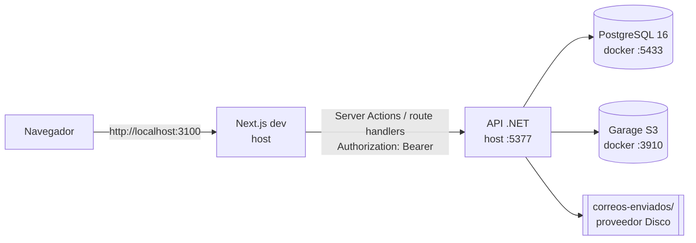
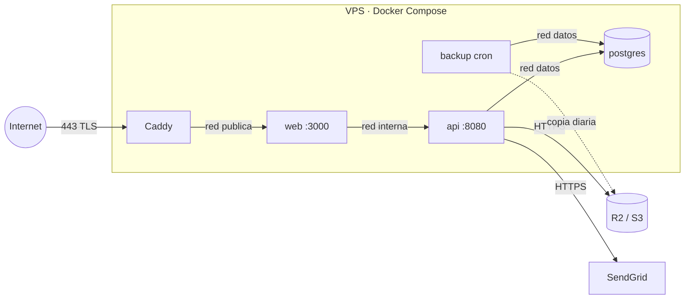

# 01 · Infraestructura

Visión general de las piezas que componen JR Tropical Fish, cómo se conectan y dónde corre cada una,
en desarrollo y en producción.

## Resumen

| Pieza | Tecnología | Desarrollo | Producción (VPS) |
|---|---|---|---|
| Web (BFF) | Next.js 16 + React 19 + Tailwind v4 | `next dev` en el host, puerto **3100** | Contenedor `web` (standalone), detrás de Caddy |
| API | ASP.NET Core .NET 10 | `dotnet run` en el host, puerto **5377** | Contenedor `api`, solo en red interna |
| Base de datos | PostgreSQL 16 | Contenedor `jrtropicalfish-postgres`, puerto **5433** | Contenedor `postgres`, volumen persistente |
| Archivos | API S3 | Garage en contenedor, puertos **3910/3913** | Cloudflare R2 / AWS S3 (recomendado) o Garage propio |
| Correo | SendGrid | Proveedor `Disco` (escribe archivos, no envía) | SendGrid |
| PDF | QuestPDF (en proceso, dentro de la API) | — | — |
| Proxy / TLS | Caddy 2 | — | Contenedor `caddy`, puertos 80/443 |
| Respaldos | `pg_dump` + cron | — | Contenedor `backup` |

Los puertos de desarrollo difieren a propósito de los de ProyectoTransporte (3000/5277/5432/3900) para
poder correr ambos proyectos a la vez.

## Desarrollo

- `npm run dev` (raíz) hace todo: libera puertos ocupados (`scripts/stop.mjs`), levanta los contenedores
  y espera a que estén *healthy* (`docker compose up -d --wait`), prepara el bucket de Garage
  (`scripts/s3-init.mjs`, idempotente) y arranca API y web en paralelo con `concurrently`.
- Al arrancar en `Development`, la API aplica las migraciones pendientes y siembra el usuario administrador
  (`SeedAdmin` en `appsettings.Development.json`).
- `npm run stop` apaga API, web y contenedores. En Windows mata el árbol de procesos (`taskkill /T`),
  porque `next dev` deja hijos escuchando el puerto.

## Producción

- **Solo Caddy publica puertos.** La API no es accesible desde Internet: la alcanza únicamente el servidor
  de Next.js por la red `interna` (marcada `internal: true`). El navegador nunca habla con la API, por eso
  no hay CORS que configurar ni token expuesto a JavaScript.
- Redes: `publica` (caddy, web), `interna` (web, api), `datos` (api, postgres, backup).
- TLS automático: Caddy obtiene y renueva el certificado de Let's Encrypt para `DOMINIO`.
- Archivos: se recomienda un S3 gestionado (R2 no cobra egreso). Garage en el mismo VPS es posible, pero
  entonces los respaldos del bucket son responsabilidad propia.
- Detalle operativo completo en [05-despliegue-vps.md](05-despliegue-vps.md).

## Configuración y secretos

| Dónde | Qué |
|---|---|
| `.env` (desarrollo, raíz) | Variables de `docker-compose.yml`. Plantilla: `.env.example` |
| `apps/api/.../appsettings.Development.json` | Conexión local, claves de Garage y JWT **solo de desarrollo** |
| `apps/web/.env.local` | `API_URL` (opcional; por defecto `http://localhost:5377`) |
| `.env.prod` (solo en el VPS) | Secretos de producción. Plantilla: `.env.prod.example`. **Nunca se versiona** |

En producción la API lee la configuración de variables de entorno con la convención de .NET
(`Postgres__Password`, `Jwt__SigningKey`, `Correo__ApiKey`…), que `docker-compose.prod.yml` arma a partir de
`.env.prod`.

## Salud y observabilidad

- `GET /api/v1/health` (anónimo) devuelve `{"status":"Healthy","checks":{"postgres":"Healthy"}}`. Lo usan el
  healthcheck del contenedor `api` y el arranque ordenado del compose (`depends_on: service_healthy`).
- Logs: `ILogger<T>` a consola; Docker los rota (`max-size 10m`, 5 archivos). Ver con
  `docker compose -f docker-compose.prod.yml logs -f api`.
- Pendiente (fase 2): centralizar logs y métricas (p. ej. OpenTelemetry → Grafana Cloud) y alertas de
  disponibilidad (Uptime Kuma o similar contra `/login` y el health).

## Fuera de alcance por ahora

- **Redis**: ProyectoTransporte lo levantaba sin usarlo. Se agrega cuando haya un caso real (caché, colas).
- **Trabajos en segundo plano** (alertas de vencimiento de certificados, recordatorios): cuando hagan falta,
  Hangfire o Quartz sobre Postgres, sin infraestructura nueva.
- **CI/CD**: fase 2. Ver [05-despliegue-vps.md](05-despliegue-vps.md#cicd-fase-2).
