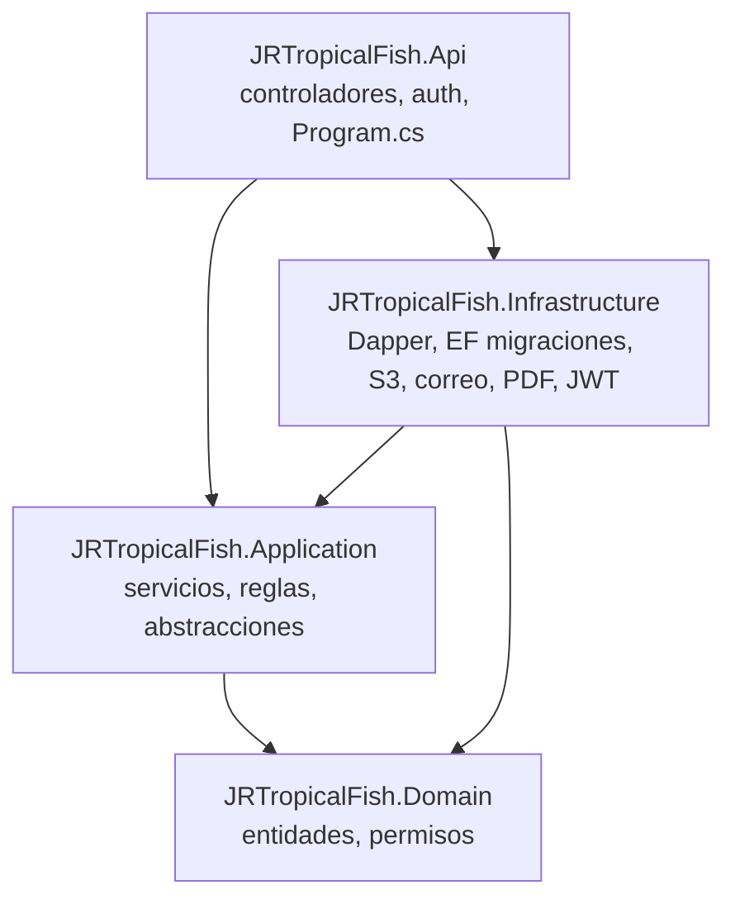

# 02 · Backend (API .NET)

## Capas

Clean Architecture en cuatro proyectos (`apps/api/src`), solución `JRTropicalFish.slnx`:



| Proyecto | Contiene | No contiene |
|---|---|---|
| `Domain` | Entidades (`EntidadBase`, `CatalogoSimple`, `Usuario`…), catálogo de permisos `Seguridad/Permisos.cs` | Dependencias de ningún paquete |
| `Application` | Un folder por módulo con `*Service.cs` (clase concreta), modelos `record`, reglas puras; `Abstractions/` con una interfaz por repositorio o servicio externo; `Comun/Resultado.cs` | SQL, HTTP, SDKs |
| `Infrastructure` | `Repositories/` (Dapper), `Persistence/` (DbContext, migraciones, sembrado), `Auth/`, `Almacenamiento/`, `Correo/`, `Informes/`; **`AddInfrastructure()`** registra todo | Reglas de negocio |
| `Api` | `Controllers/` (`api/v1/...`), `Auth/RequierePermisoAttribute`, `Comun/ResultadoHttp`, `Startup/AdminSeeder`, `Program.cs` | Lógica de negocio |

Sin MediatR, AutoMapper ni FluentValidation: los controladores reciben los servicios por constructor
primario y los servicios validan y devuelven `Resultado<T>`.

## Flujo de una petición

```
Controller ──► Service (Application) ──► IRepository ──► Repository (Dapper) ──► fn_/sp_ PL/pgSQL
   │                 │
   │                 └─ devuelve Resultado<T> (Ok | Error tipado)
   └─ ResultadoHttp.ARespuesta(): 200/204 | 400/403/404/409 con { error }
```

## Convenciones

- **Rutas**: `api/v1/<modulo>`; nombres en español (`api/v1/inventario/movimientos`).
- **Errores esperados** (regla de negocio): `Resultado` con `TipoError` → `Validacion` 400, `NoEncontrado`
  404, `Conflicto` 409, `Prohibido` 403. **Errores inesperados**: excepción → manejador global → 500
  `{ error }` (mensaje real solo en Development).
- **Ids**: `Guid.CreateVersion7()` generados en la aplicación (`EntidadBase.Id`).
- **Fechas**: `DateTime` UTC para marcas de tiempo (`timestamptz`); `DateOnly` para fechas de calendario
  (vencimiento de un certificado). La hora local de negocio es `America/Bogota` (`IReloj.Hoy`).
- **Hora inyectable**: usar `IReloj`, nunca `DateTime.Now` en reglas, para poder probarlas.
- **Configuración**: una clase `*Options` con `SectionName` por sección de `appsettings`.
- **Proveedores externos por configuración**: correo (`Correo:Proveedor` = `Disco` | `SendGrid`), S3
  (`Almacenamiento:Endpoint`). Ningún archivo fuera de su adaptador conoce el SDK del proveedor.

## Autenticación y autorización

- JWT HMAC-SHA256 emitido por la propia API (`JwtTokenService`); sin ASP.NET Identity (solo su
  `PasswordHasher<T>`, envuelto en `PasswordHasherAdapter`).
- Claims: `sub`, `iat` (emisión), nombre, email, `perfil` y **un claim `permiso` por cada permiso**
  (`modulo:accion`). Expiración: `Jwt:ExpiracionMinutos` (480).
- **Seguro por defecto**: `FallbackPolicy` exige usuario autenticado en todo endpoint; lo público se marca
  `[AllowAnonymous]` (login, health).
- Autorización fina: `[RequierePermiso(Permisos.InventarioAjustar)]` en controlador o acción.
  `PermisoPolicyProvider` crea la política al vuelo.
- Perfiles plantilla sembrados: **Administrador** (todo), **Operativo**, **Consulta**. Editables (salvo el
  nombre), no eliminables.

### Políticas de acceso

| Política | Regla | Dónde |
|---|---|---|
| Contraseña | Mínimo 8 caracteres, letras y números, máximo 128 | `Application/Seguridad/ReglasPassword.cs` |
| Bloqueo | 5 intentos fallidos seguidos → cuenta bloqueada 15 min; un administrador puede desbloquear | `ReglasBloqueo`, `AuthService.LoginAsync` |
| Mensajes de login | Email inexistente y clave incorrecta dan el mismo mensaje (401). Bloqueo e inactividad: 403 | `AuthService` |
| Revocación | Token emitido antes de `usuarios.sesion_invalida_antes` → 401 en la siguiente petición | `Api/Auth/ValidacionSesion.cs` |
| Último administrador | Nunca queda el sistema sin un usuario activo con `usuarios:editar` en un perfil activo | `UsuarioService`, `PerfilService`, `fn_administradores_contar` |
| Autodesactivación | Nadie puede desactivar su propio usuario | `UsuarioService.CambiarEstadoAsync` |

**Qué revoca sesiones** (mueve `sesion_invalida_antes`): desactivar al usuario, cambiar su contraseña (la
propia o un restablecimiento), cambiarle el perfil, y cambiar los permisos o el estado de su perfil. Al
cambiar la propia contraseña, la API devuelve un token nuevo y el web lo guarda: el usuario sigue en la
sesión actual y las demás se cierran. Editar nombre, email o la descripción de un perfil **no** revoca.

### Endpoints de seguridad

| Método y ruta | Permiso |
|---|---|
| `POST /api/v1/auth/login` | Anónimo |
| `GET /api/v1/auth/yo` · `POST /api/v1/auth/cambiar-password` | Sesión |
| `GET /api/v1/seguridad/usuarios[/{id}[/historial]]` | `usuarios:leer` |
| `POST /api/v1/seguridad/usuarios` | `usuarios:crear` |
| `PUT /api/v1/seguridad/usuarios/{id}` · `POST .../{id}/desbloquear` | `usuarios:editar` |
| `PUT /api/v1/seguridad/usuarios/{id}/estado` | `usuarios:eliminar` (desactivar/reactivar) |
| `GET /api/v1/seguridad/perfiles[/{id}[/historial]]` · `GET .../permisos` | `perfiles:leer` |
| `POST` · `PUT /{id}` · `DELETE /{id}` en `/api/v1/seguridad/perfiles` | `perfiles:crear` · `editar` · `eliminar` |

### Endpoints del CRM

Todo bajo `api/v1/crm`. El alcance (`AlcanceCrm`) sale del token: un comercial sin `crm:ver-todo`
solo ve lo suyo (404 en lo ajeno). Reglas de negocio en [`../dominio/crm.md`](../dominio/crm.md).

| Método y ruta | Permiso |
|---|---|
| `GET /clientes[/{id}[/historial]]` | `clientes:leer` |
| `GET /clientes/{id}/relacionados` (oportunidades, ventas, vuelos, tareas) | `clientes:leer` + `crm:leer` |
| `POST` · `PUT /{id}` · `DELETE /{id}` en `/clientes` (`codigo` opcional al crear: importación) | `clientes:editar` |
| `GET /comerciales` | `crm:leer` |
| `GET /oportunidades[/{id}[/historial]]` · `/ventas…` · `/tracking…` · `/tareas…` | `crm:leer` |
| `POST` · `PUT /{id}` · `DELETE /{id}` en `/oportunidades`; `PUT /{id}/etapa`; `POST /{id}/ganar` | `crm:vender` |
| `POST` · `PUT /{id}` en `/ventas` | `ventas:gestionar` |
| `PUT /tracking/{id}` · `PUT /tracking/{id}/fase` | `tracking:gestionar` |
| `POST` · `PUT /{id}` · `PUT /{id}/estado` · `DELETE /{id}` en `/tareas` | `crm:vender` |
| `GET /metricas/dashboard?mes=` · `GET /metricas/parametros` · `GET /metricas/metas?mes=` | `metas:leer` |
| `PUT /metricas/parametros` · `PUT /metricas/metas` | `metas:editar` |

**Concurrencia "comparar y escribir"**: cambiar etapa, ganar, cambiar fase y mover una tarea reciben
el estado que vio el usuario. El procedimiento hace `UPDATE … WHERE estado = esperado` y, si no
afectó filas, lanza `SQLSTATE JR001`; `RepositorioCrm.EjecutarSiNoCambioAsync` lo traduce a
`false` y el servicio a 409. Usar este patrón en toda transición de estado nueva.

**Columnas generadas**: `ventas.total_cop` y `tracking_vuelos.porcentaje_doa` las calcula Postgres
(`HasComputedColumnSql(..., stored: true)`); nunca se escriben desde C#.

### Endpoints del catálogo

Todo bajo `api/v1/catalogos`. Reglas en [`../dominio/catalogos.md`](../dominio/catalogos.md).

| Método y ruta | Permiso |
|---|---|
| `GET /productos[/{id}[/historial]]` (precios solo con `precios:leer`; costo solo con `catalogos:ver-costos`) | `catalogos:leer` |
| `POST` · `PUT /{id}` · `DELETE /{id}` en `/productos` (enviar `precios` exige `precios:editar`) | `catalogos:editar` |
| `GET /precios/listas[/{id}/historial]` · `GET /precios/parametros` | `precios:leer` |
| `POST` · `PUT /{id}` en `/precios/listas`; `POST /precios/listas/{id}/recalcular`; `PUT /precios/parametros` | `precios:editar` |
| `GET /centros-acopio` | `catalogos:leer` o `proveedores:leer` |
| `POST` · `PUT /{id}` · `DELETE /{id}` en `/centros-acopio` | `catalogos:editar` |
| `GET /proveedores[/{id}[/historial]]` · escritura | `proveedores:leer` · `proveedores:editar` |

**Precios del producto**: `sp_producto_guardar` recibe los precios como `jsonb` y solo toca las listas
indicadas (`null`/0 quita el precio). El recálculo lo hace C# (`ReglasPrecio`) y
`sp_precios_guardar_lote` solo escribe. La auditoría registra cada precio como campo
`Precio {Lista} ({CODIGO})`; el código entre paréntesis permite quitar los de costo del historial.

### Endpoints de inventario, compras y pedidos de cliente

Reglas en [`../dominio/inventario.md`](../dominio/inventario.md). Costos solo con `catalogos:ver-costos`.

| Método y ruta | Permiso |
|---|---|
| `GET /inventario/{existencias, lotes, movimientos, necesidades, acuarios}` | `inventario:leer` |
| `GET /inventario/tableros/{bodega, proveedores, clientes, trazabilidad[/{id}]}` (`?desde&hasta`, por defecto 30 días; clientes con alcance del CRM) | `inventario:leer` |
| `POST /inventario/operaciones` (lista de operaciones, todo o nada; `ajuste` exige `inventario:ajustar`) | `inventario:operar` |
| `POST /inventario/saldo-inicial` · `POST` · `PUT /{id}` en `/inventario/acuarios` | `inventario:ajustar` |
| `GET /compras/{ofertas, pedidos, recepciones}[/{id}]` | `inventario:leer` |
| `POST` · `PUT /{id}` en `/compras/ofertas` y `/compras/pedidos`; `PUT /compras/pedidos/{id}/estado` | `compras:gestionar` |
| `POST /compras/recepciones` (crea un lote por línea) | `compras:recibir` |
| `GET /pedidos[/{id}[/historial]]` · `GET /pedidos/por-venta/{ventaId}` (204 si no hay) | `inventario:leer` (+ alcance del CRM) |
| `POST` · `PUT /{id}` · `PUT /{id}/estado` en `/pedidos` | `pedidos:gestionar` |
| `POST /pedidos/{id}/despachar` | `pedidos:despachar` |

**Motor de stock**: toda operación termina en `sp_inventario_mover_uno`, que bloquea la existencia de
origen (`FOR UPDATE`) y nunca la deja negativa. SQLSTATE propios, traducidos por
`RepositorioInventario.EjecutarConFallaAsync` y `FallasInventario.AError`:

| SQLSTATE | Significado | HTTP |
|---|---|---|
| `JR001` | El estado cambió entretanto («comparar y escribir») | 409 |
| `JR002` | No hay suficiente stock en el origen | 409 |
| `JR003` | El despacho supera lo pendiente de la línea | 400 |

Los consecutivos de inventario (`DISP`, `PP`, `REC`, `LOT`, `PC`) usan 4 dígitos; los del CRM, 3.

### Endpoints de exportaciones

Todo bajo `api/v1/exportaciones`. Reglas en [`../dominio/exportaciones.md`](../dominio/exportaciones.md).

| Método y ruta | Permiso |
|---|---|
| `GET /configuracion` · `GET /configuracion/logo` · `GET /clientes/{clienteId}` | `exportaciones:leer` |
| `PUT /configuracion/{empresa, tarifas, cargos}` · `POST /configuracion/{logo, cajas, bolsas}` | `exportaciones:configurar` |
| `PUT /clientes/{clienteId}` | `exportaciones:gestionar` |
| `GET /embarques[/{id}[/historial]]` · `GET /embarques/por-venta/{ventaId}` (204 si no hay) · `GET /embarques/{id}/documentos/{tipo}` (PDF) | `exportaciones:leer` |
| `POST /embarques` · `PUT /embarques/{id}[/lineas, /doa]` · `POST /embarques/{id}/facturar` · `POST /embarques/{id}/documentos/{tipo}/enviar` | `exportaciones:gestionar` |
| `PUT /embarques/{id}/empaque` | `exportaciones:empacar` |
| `PUT /embarques/{id}/estado` | `leer` + (`gestionar`, o `empacar` solo para empacado ↔ confirmado) |

**AUNAP** (`AunapController`, también bajo `api/v1/exportaciones`):

| Método y ruta | Permiso |
|---|---|
| `GET /aunap/especies` · `GET /aunap/productos` · `GET /embarques/{id}/aunap` (pedido / autorizado / empacado) | `exportaciones:leer` |
| `POST /aunap/especies/importar` · `PUT /aunap/productos/{productoId}` · `POST /aunap/productos/enlazar-automatico` | `exportaciones:configurar` |
| `PUT /embarques/{id}/aunap/permiso` | `exportaciones:gestionar` |

Los documentos `solicitud_aunap`, `packing_aduana` y `factura_aduana` van por el mismo
`GET /embarques/{id}/documentos/{tipo}`. Responden 400 si alguna especie no tiene código AUNAP o, en los de
aduana, si falta el empaque real.

**PDF**: cada documento arma su `InformeModelo` en `Application/Exportaciones/DocumentosEmbarque.cs`. El modelo
ganó logo, datos de la empresa en el encabezado, bloques lado a lado (`SeccionBloques`), alineación por columna,
filas de totales, tablas compactas, hoja horizontal y pie propio; todo opcional (los informes anteriores no cambian).
La factura emitida se guarda en S3 (`embarque_documentos`) y se sirve tal cual. En el web, los PDF y el logo van
por route handlers con streaming (`app/archivos/exportaciones/...`), nunca por el proxy.

### Endpoints de sanidad

Todo bajo `api/v1/sanidad`. Reglas en [`../dominio/sanidad.md`](../dominio/sanidad.md).

| Método y ruta | Permiso |
|---|---|
| `GET /{medicamentos, alimentos, dietas, fichas, fichas/{productoId}, protocolos, protocolos/{id}, parametros, acuarios}` · `GET /mi-dia` · `GET /tablero` · `GET /tratamientos[?vigentes=true]` · `GET /tratamientos/{id}[/reporte]` · `GET /historial/{entidad}/{id}` | `sanidad:leer` |
| `POST/PUT /{medicamentos, alimentos, dietas, protocolos}` · `DELETE /dietas/{id}` · `PUT /fichas/{productoId}` · `PUT /parametros` · `PUT /acuarios/{id}/responsable` · `POST /tratamientos/{id}/reporte` | `sanidad:gestionar` |
| `PUT /protocolos/{id}/estado` | `gestionar`; aprobar exige además `sanidad:aprobar-protocolo` |
| `POST /tratamientos` (desde protocolo aprobado; sin protocolo exige `gestionar`) · `PUT /tratamientos/{id}/estado` · `PUT /aplicaciones/{id}/{aplicar, omitir}` · `POST /alimentacion` | `sanidad:operar` |
| `GET /reservas/pedido/{pedidoId}` | `inventario:leer` |
| `PUT /reservas` (fija lo reservado de una línea en un lote y acuario; 0 = quitar) | `pedidos:despachar` |

**Nuevo SQLSTATE `JR004`**: acuario en tratamiento o en tiempo de retiro (409). Lo lanzan `sp_reserva_fijar` y
`sp_pedido_cliente_despachar`, que la migración `FuncionesSanidad` rehízo con la misma firma: además respeta lo
reservado para otros pedidos y consume la reserva de la línea. Los `RAISE EXCEPTION` sin código (P0001) de los
procedimientos de sanidad llegan como validación (400) por `RepositorioSanidad.EjecutarValidandoAsync`.

El tablero y Mi día se calculan en C# (`SanidadService` + `ReglasSanidad`) a partir de cuatro lecturas planas
(`fn_sanidad_acuarios`, `fn_sanidad_existencias`, `fn_sanidad_tratamientos_vigentes`, `fn_sanidad_reservas`), para
que las reglas de estado y ayuno estén probadas sin base de datos.

## Transversales disponibles

| Pieza | Para qué | Dónde |
|---|---|---|
| `ComparadorAuditoria` / `ComparadorColecciones` | Diff campo a campo para el historial | `Application/Auditoria` |
| `ServicioAuditoria` | Escribir el historial (usuario y hora actuales) y leerlo; usar este, no el repositorio | `Application/Auditoria` |
| `IAuditoriaRepository` | Persistencia del historial (`auditoria`, jsonb) | `Infrastructure/Repositories` |
| `IAlmacenArchivos` + `ClaveArchivo` + `DetectorTipoArchivo` | Subir/descargar documentos; clave sin datos del usuario; tipo real por magic bytes | `Application/Archivos`, `Infrastructure/Almacenamiento` |
| `IGeneradorInformePdf` + `InformeModelo` | PDF (proforma, packing list, acta…) sin tocar QuestPDF | `Application/Informes`, `Infrastructure/Informes` |
| `IServicioCorreo` (+ `CorreoModoPruebas`) | Enviar correo con adjuntos; redirigir todo en staging | `Infrastructure/Correo` |
| `Resultado<T>` | Errores de negocio sin excepciones | `Application/Comun` |

## Agregar un módulo (receta)

1. **Domain**: entidades del módulo (heredan `EntidadBase` o `CatalogoSimple`) y permisos en `Permisos.cs`
   (+ `Todos` + `PerfilesPlantilla`).
2. **Infrastructure/Persistence**: configurar las entidades en `AppDbContext` (`Configurar<Modulo>`), generar
   la migración de esquema (`npm run migracion:nueva -- <Nombre>`) y **revisarla a mano**.
3. Segunda migración con las funciones `fn_*` / procedimientos `sp_*` y `SembradoPermisos.Aplicar(...)`.
4. **Application**: `I<Modulo>Repository` en `Abstractions/`, `<Modulo>Service` y modelos `record`.
5. **Infrastructure**: `<Modulo>Repository` (Dapper) y registro en `AddInfrastructure()`.
6. **Api**: `<Modulo>Controller` con `[RequierePermiso]` y `ResultadoHttp`.
7. **Tests**: reglas y servicios con fakes escritos a mano (sin base de datos).
8. **Web**: permisos en `lib/permisos.ts`, ítem en `lib/navegacion.ts`, páginas en `app/(dashboard)/<modulo>`.

## Maestros

Una **tabla por maestro** (todas con la forma de `CatalogoSimple`: código en mayúsculas, nombre,
activo, borrado lógico con únicos parciales), pero **un solo juego de código**:

- `Application/Maestros/RegistroMaestros` es la lista blanca: clave de la URL → tabla, nombre y singular.
- `fn_maestro_*` / `sp_maestro_*` reciben la tabla como parámetro, la validan contra `fn_maestro_tabla`
  (segunda lista blanca, en SQL) y la citan con `format('%I')`. Nunca se concatena.
- API genérica `api/v1/maestros/{clave}`; `?soloActivos=true` lo puede pedir cualquier usuario con sesión
  (son las opciones de los formularios); la lista completa exige `maestros:leer`.
- El web (`/administracion/maestros`) lee los maestros disponibles de la API: no cambia al agregar uno.

**Agregar un maestro**: (1) clase en `Domain/Maestros/Maestros.cs` que herede `CatalogoSimple`; (2) `DbSet`
y `ConfigurarCatalogo<T>(..., "tabla")` en `AppDbContext`; (3) migración que cree la tabla, recree
`fn_maestro_tabla` incluyéndola (`CREATE OR REPLACE`, misma firma) y siembre valores si aplica;
(4) entrada en `RegistroMaestros.Todos`.

Un valor desactivado o eliminado deja de ofrecerse, pero quien ya lo tiene lo conserva (las funciones de
lectura de empleados unen los maestros sin filtrar `eliminado_en`, y el servicio solo exige "activo" cuando
el valor cambia).

## Archivos: foto de empleado (primer endpoint de archivos)

Patrón para los próximos módulos con documentos:

- **Subida**: `POST .../{id}/foto` multipart (campo `archivo`) con `[RequestSizeLimit]` y
  `[RequestFormLimits]`; el servicio lee el contenido, decide el tipo con `DetectorTipoArchivo` (no con
  el nombre ni el `Content-Type`), arma la clave con `ClaveArchivo.ParaDocumento`, sube, actualiza la fila
  y borra el archivo anterior. En el web, Server Action + `apiUpload`.
- **Descarga**: `GET .../{id}/foto` devuelve el stream; el web la sirve con el route handler
  `app/archivos/empleados/[id]/foto/route.ts`, que hace streaming de `response.body`.
- La API expone una **versión** (`fotoVersion`, el id del documento en la clave), nunca la clave del
  almacén; el web la pone en `?v=` y así la imagen se puede cachear como inmutable.

## Pruebas

- `apps/api/tests/JRTropicalFish.Tests`: xUnit, una carpeta por área, fakes escritos a mano
  (`SeguridadEnMemoria`, `AdministracionEnMemoria`, `CrmEnMemoria`, `CatalogosEnMemoria`), nombres de prueba en español que se leen como regla
  (`Un_usuario_inactivo_no_inicia_sesion`).
- Se prueban las reglas puras y los servicios. El SQL se verifica ejecutando la API contra la base local.
- `npm test` (raíz) ejecuta `dotnet test` sobre la solución.
