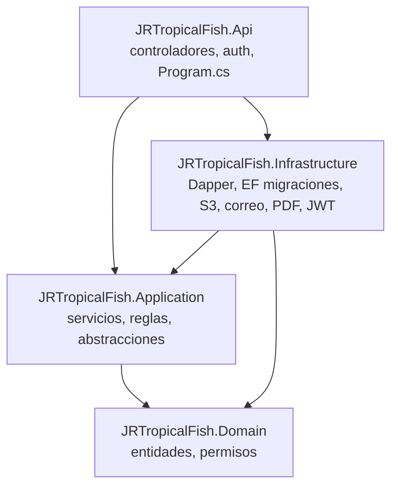

# 02 · Backend (API .NET)

## Capas

Clean Architecture en cuatro proyectos (`apps/api/src`), solución `JRTropicalFish.slnx`:



| Proyecto | Contiene | No contiene |
|---|---|---|
| `Domain` | Entidades (`EntidadBase`, `CatalogoSimple`, `Usuario`…), catálogo de permisos `Seguridad/Permisos.cs` | Dependencias de ningún paquete |
| `Application` | Un folder por módulo con `*Service.cs` (clase concreta), modelos `record`, reglas puras; `Abstractions/` con una interfaz por repositorio o servicio externo; `Comun/Resultado.cs` | SQL, HTTP, SDKs |
| `Infrastructure` | `Repositories/` (Dapper), `Persistence/` (DbContext, migraciones, sembrado), `Auth/`, `Almacenamiento/`, `Correo/`, `Informes/`; **`AddInfrastructure()`** registra todo | Reglas de negocio |
| `Api` | `Controllers/` (`api/v1/...`), `Auth/RequierePermisoAttribute`, `Comun/ResultadoHttp`, `Startup/AdminSeeder`, `Program.cs` | Lógica de negocio |

Sin MediatR, AutoMapper ni FluentValidation: los controladores reciben los servicios por constructor
primario y los servicios validan y devuelven `Resultado<T>`.

## Flujo de una petición

```
Controller ──► Service (Application) ──► IRepository ──► Repository (Dapper) ──► fn_/sp_ PL/pgSQL
   │                 │
   │                 └─ devuelve Resultado<T> (Ok | Error tipado)
   └─ ResultadoHttp.ARespuesta(): 200/204 | 400/403/404/409 con { error }
```

## Convenciones

- **Rutas**: `api/v1/<modulo>`; nombres en español (`api/v1/inventario/movimientos`).
- **Errores esperados** (regla de negocio): `Resultado` con `TipoError` → `Validacion` 400, `NoEncontrado`
  404, `Conflicto` 409, `Prohibido` 403. **Errores inesperados**: excepción → manejador global → 500
  `{ error }` (mensaje real solo en Development).
- **Ids**: `Guid.CreateVersion7()` generados en la aplicación (`EntidadBase.Id`).
- **Fechas**: `DateTime` UTC para marcas de tiempo (`timestamptz`); `DateOnly` para fechas de calendario
  (vencimiento de un certificado). La hora local de negocio es `America/Bogota` (`IReloj.Hoy`).
- **Hora inyectable**: usar `IReloj`, nunca `DateTime.Now` en reglas, para poder probarlas.
- **Configuración**: una clase `*Options` con `SectionName` por sección de `appsettings`.
- **Proveedores externos por configuración**: correo (`Correo:Proveedor` = `Disco` | `SendGrid`), S3
  (`Almacenamiento:Endpoint`). Ningún archivo fuera de su adaptador conoce el SDK del proveedor.

## Autenticación y autorización

- JWT HMAC-SHA256 emitido por la propia API (`JwtTokenService`); sin ASP.NET Identity (solo su
  `PasswordHasher<T>`, envuelto en `PasswordHasherAdapter`).
- Claims: `sub`, nombre, email, `perfil` y **un claim `permiso` por cada permiso** (`modulo:accion`).
  Un cambio de perfil aplica en el siguiente inicio de sesión. Expiración: `Jwt:ExpiracionMinutos` (480).
- **Seguro por defecto**: `FallbackPolicy` exige usuario autenticado en todo endpoint; lo público se marca
  `[AllowAnonymous]` (login, health).
- Autorización fina: `[RequierePermiso(Permisos.InventarioAjustar)]` en controlador o acción.
  `PermisoPolicyProvider` crea la política al vuelo.
- Perfiles plantilla sembrados: **Administrador** (todo), **Operativo**, **Consulta**. Editables, no
  eliminables.

## Transversales disponibles

| Pieza | Para qué | Dónde |
|---|---|---|
| `ComparadorAuditoria` / `ComparadorColecciones` | Diff campo a campo para el historial | `Application/Auditoria` |
| `IAuditoriaRepository` | Guardar y listar el historial (`auditoria`, jsonb) | `Infrastructure/Repositories` |
| `IAlmacenArchivos` + `ClaveArchivo` + `DetectorTipoArchivo` | Subir/descargar documentos; clave sin datos del usuario; tipo real por magic bytes | `Application/Archivos`, `Infrastructure/Almacenamiento` |
| `IGeneradorInformePdf` + `InformeModelo` | PDF (proforma, packing list, acta…) sin tocar QuestPDF | `Application/Informes`, `Infrastructure/Informes` |
| `IServicioCorreo` (+ `CorreoModoPruebas`) | Enviar correo con adjuntos; redirigir todo en staging | `Infrastructure/Correo` |
| `Resultado<T>` | Errores de negocio sin excepciones | `Application/Comun` |

## Agregar un módulo (receta)

1. **Domain**: entidades del módulo (heredan `EntidadBase` o `CatalogoSimple`) y permisos en `Permisos.cs`
   (+ `Todos` + `PerfilesPlantilla`).
2. **Infrastructure/Persistence**: configurar las entidades en `AppDbContext` (`Configurar<Modulo>`), generar
   la migración de esquema (`npm run migracion:nueva -- <Nombre>`) y **revisarla a mano**.
3. Segunda migración con las funciones `fn_*` / procedimientos `sp_*` y `SembradoPermisos.Aplicar(...)`.
4. **Application**: `I<Modulo>Repository` en `Abstractions/`, `<Modulo>Service` y modelos `record`.
5. **Infrastructure**: `<Modulo>Repository` (Dapper) y registro en `AddInfrastructure()`.
6. **Api**: `<Modulo>Controller` con `[RequierePermiso]` y `ResultadoHttp`.
7. **Tests**: reglas y servicios con fakes escritos a mano (sin base de datos).
8. **Web**: permisos en `lib/permisos.ts`, ítem en `lib/navegacion.ts`, páginas en `app/(dashboard)/<modulo>`.

## Pruebas

- `apps/api/tests/JRTropicalFish.Tests`: xUnit, una carpeta por área, fakes escritos a mano
  (`UsuariosFalsos`, `RelojFijo`), nombres de prueba en español que se leen como regla
  (`Un_usuario_inactivo_no_inicia_sesion`).
- Se prueban las reglas puras y los servicios. El SQL se verifica ejecutando la API contra la base local.
- `npm test` (raíz) ejecuta `dotnet test` sobre la solución.
