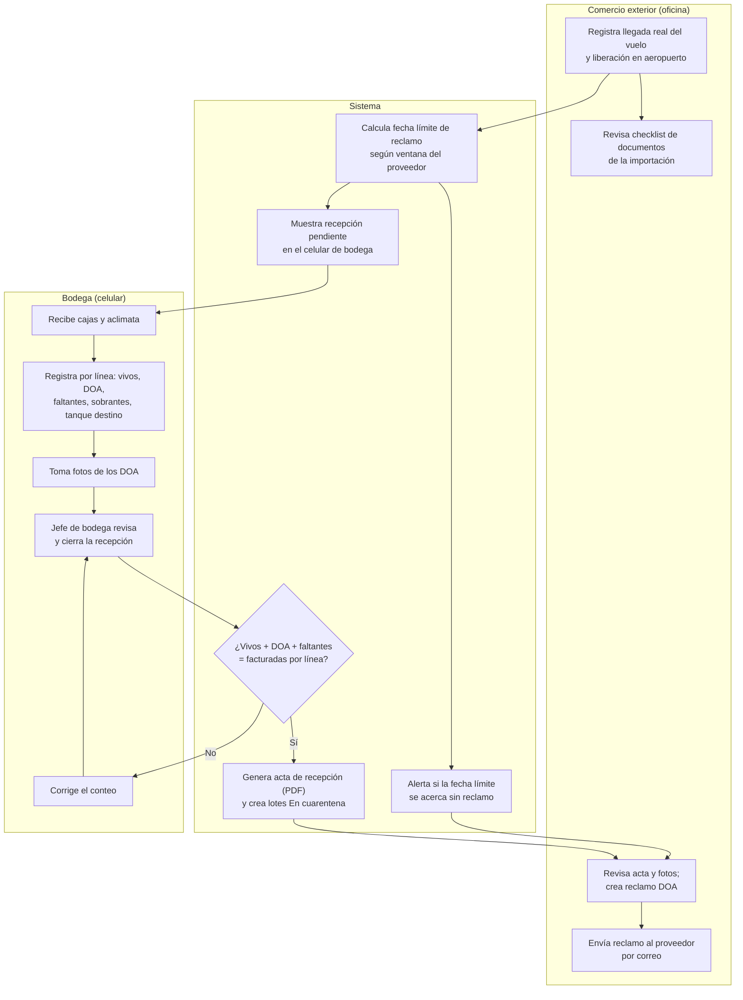

# Flujo 1 — Recepción de una importación

Desde que el vuelo de una importación llega y la carga se libera en el aeropuerto, hasta que los peces
quedan en tanques de cuarentena como lotes del inventario y el reclamo DOA al proveedor queda listo para
enviarse dentro de la ventana.

**Ideas que representa** (de [`../../03-idear/brainstorming.md`](../../03-idear/brainstorming.md)):
recepción por línea con fotos, acta en PDF, lotes en cuarentena automáticos, fecha límite de reclamo,
expediente con checklist (PS-4); registro desde el celular (PS-3); inventario por lote (PS-1).

**Reglas de dominio**: [`../../../dominio/importaciones.md`](../../../dominio/importaciones.md) (reglas 4 a
10) y [`../../../dominio/inventario.md`](../../../dominio/inventario.md) (reglas 7 a 9).



## Boceto de pantallas

### P1 — Recepciones pendientes (celular, bodega)

```text
+----------------------------------+
| Recepciones pendientes           |
|----------------------------------|
| OC-2026-0012  Proveedor X        |
| AWB 123-45678901  8 cajas        |
| Llegó: hoy 05:40                 |
| Reclamo vence: mañana 05:40      |
|                [ Recibir ]       |
+----------------------------------+
```

### P2 — Conteo por línea (celular, bodega)

```text
+----------------------------------+
| OC-2026-0012 · Línea 2 de 6      |
| Paracheirodon axelrodi · M       |
| Facturadas: 500                  |
|----------------------------------|
| Vivos      [ 480 ]               |
| DOA        [  20 ]  [ Foto ]     |
| Faltantes  [   0 ]               |
| Sobrantes  [   0 ]               |
| Tanque     [ Q-03 (cuarentena) ] |
|----------------------------------|
| Cuadra: 480 + 20 + 0 = 500  OK   |
| [ Anterior ]       [ Siguiente ] |
+----------------------------------+
```

### P3 — Cierre de recepción (celular o computador, jefe de bodega)

Resumen de todas las líneas (facturadas, vivos, DOA, % DOA), fotos adjuntas y botón **Cerrar y generar
acta**. Al cerrar se muestra el enlace al PDF del acta y los lotes creados.

### P4 — Expediente de la importación (computador, comercio exterior)

Pestañas: Resumen · Documentos (checklist con estado: cargado / faltante / vencido) · Recepción (acta y
fotos) · Lotes · Reclamo (fecha límite, botón **Crear reclamo** pre-llenado con DOA y faltantes) · Costos.

## Notas

- La recepción **nunca se bloquea por documentos faltantes**: los peces se reciben y aclimatan primero. Lo
  que se bloquea es la liberación de cuarentena y la liquidación.
- La fecha límite de reclamo se calcula desde la llegada real del vuelo, no desde el cierre de la
  recepción, porque así la cuentan los proveedores (**por validar**).
- El paso de aclimatación puede tardar horas; el conteo se registra después, pero la llegada se registra de
  inmediato para no perder tiempo de la ventana.
- Supuestos clave de este flujo: hay señal en la bodega; el conteo línea por línea es viable en el tiempo
  disponible; los proveedores aceptan fotos como evidencia (ver
  [`../../05-testear/plan-pruebas.md`](../../05-testear/plan-pruebas.md)).
