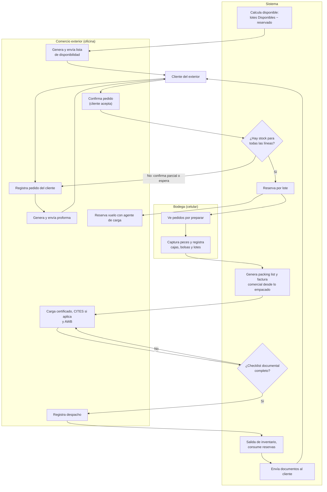

# Flujo 2 — Proforma y despacho de una exportación

Desde que se envía la lista de disponibilidad al cliente, hasta que el pedido se despacha con sus documentos
completos, el inventario se descuenta y el cliente recibe los documentos por correo.

**Ideas que representa** (de [`../../03-idear/brainstorming.md`](../../03-idear/brainstorming.md)):
disponibilidad y proforma en PDF, reserva al confirmar (PS-5); empaque por caja desde el celular, packing
list y factura generados del empaque, checklist documental, salida de inventario al despachar, envío de
documentos (PS-6).

**Reglas de dominio**: [`../../../dominio/exportaciones.md`](../../../dominio/exportaciones.md) (reglas 1 a
12).



## Boceto de pantallas

### P1 — Pedido (computador, comercio exterior)

```text
Pedido PD-2026-0041 · Cliente: Importador Y (Miami) · USD · FOB · Vuelo: 2026-12-03
Estado: Confirmado
------------------------------------------------------------------------------------
Especie / talla                   Pedido  Disponible  Reservado  Empacado  Precio
Paracheirodon axelrodi · M          1000        1450       1000         -    0,45
Pterophyllum altum · L                40          35         35         -    9,00  (!) sin cobertura completa
------------------------------------------------------------------------------------
[ Proforma v2 (PDF) ]  [ Enviar al cliente ]  [ Cancelar pedido ]
Documentos: Packing list (pendiente) · Factura (pendiente) · Certificado (falta) · CITES (falta) · AWB (falta)
```

### P2 — Empaque (celular, bodega)

```text
+----------------------------------+
| PD-2026-0041 · Caja 3 de 12      |
|----------------------------------|
| Especie   [ P. axelrodi · M  v ] |
| Lote      [ L-0087 (tanque V-12)]|
| Cantidad  [ 200 ]                |
| Bolsas    [ 4 ]  máx 50/bolsa OK |
| [ + Otra especie en esta caja ]  |
| Peso caja [ 14,5 kg ]            |
| [ Guardar caja ]                 |
+----------------------------------+
```

### P3 — Documentos y despacho (computador, comercio exterior)

Checklist con estado de cada documento (generado / cargado / falta), botón **Generar packing list y
factura** (habilitado cuando el empaque está completo), campos de AWB, vuelo, peso bruto y peso cobrable, y
botón **Registrar despacho** (habilitado solo con el checklist completo). Al registrar, opción **Enviar
documentos al cliente**.

## Notas

- La proforma no reserva; la reserva ocurre al confirmar. Esto evita bloquear stock por cotizaciones que
  no se concretan, a cambio de que dos proformas puedan ofrecer el mismo stock (**por validar** si el
  negocio prefiere reservar desde la proforma con vencimiento).
- El empaque traslada los peces a la "zona de empaque" (siguen en inventario); la salida ocurre solo al
  despachar. Si el vuelo se cancela, los peces vuelven a tanques sin descuadrar el inventario.
- Packing list y factura salen del empaque real: si se empacan 35 en lugar de 40, los documentos dicen 35 y
  la reserva sobrante se libera.
- Supuestos clave de este flujo: la bodega puede registrar el empaque caja por caja sin retrasar el vuelo;
  los documentos exigidos por país destino se pueden parametrizar; los clientes aceptan proforma y
  documentos en el formato PDF del sistema (ver
  [`../../05-testear/plan-pruebas.md`](../../05-testear/plan-pruebas.md)).
