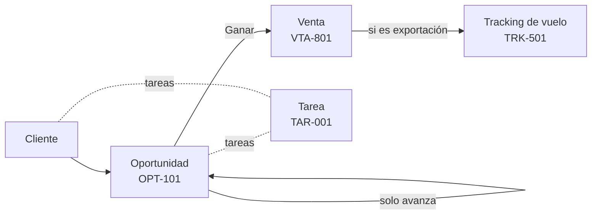

# CRM comercial y logístico

Gestión del ciclo comercial de JR Tropical Fish: prospección y negociación (pipeline), venta firme
nacional o de exportación, seguimiento del vuelo con control DOA, tareas diarias de los comerciales,
y metas y comisiones. Reemplaza el Excel `JR_Control_Comercial_Master` (6 hojas).

**Principio**: cero doble digitación. El detalle por especie y bolsa vive en la app de inventario;
el CRM maneja valor comercial, cajas, etapa, tareas y trazabilidad aérea (AWB / DOA).

## Flujo



| Entidad | Código | Pantalla |
|---|---|---|
| Cliente | `CLI-001` | `/crm/clientes` (+ ficha `/crm/clientes/{id}`) |
| Oportunidad | `OPT-101` | `/crm/pipeline` (Kanban) |
| Venta | `VTA-801` | `/crm/ventas` |
| Tracking de vuelo | `TRK-501` | `/crm/vuelos` (torre de control) |
| Tarea | `TAR-001` | `/crm/tareas` (Kanban) |
| Metas y parámetros | — | `/crm/metas`, dashboard en `/crm` |

Los códigos salen de la tabla `consecutivos` (bloqueo por prefijo). Si una operación falla después
de reservar el código, queda un hueco en la numeración: es aceptable y evita duplicados.

## Reglas

### Pipeline (máquina de estados)

Etapas: `1. Prospección` → `2. Stocklist enviado` → `3. Pre-invoice` → `4. Aprobación vuelo` →
`5. Ganada`, más `Perdida`.

- Solo se avanza: a cualquier etapa **posterior** (se puede saltar) o a **Perdida** (motivo
  obligatorio). No hay retroceso. `Application/Crm/ReglasCrm.cs` → `ReglasPipeline`.
- **Ganada y Perdida son terminales**: el tablero no ofrece botones y la API responde 409.
- Una oportunidad cerrada solo permite editar las notas de seguimiento; una ganada no se elimina.
- El cambio es "comparar y escribir": el cliente envía la etapa que vio; si otro la cambió antes, 409.
  Dos clics simultáneos no pueden crear dos ventas.

### Ganar → Venta (+ Tracking)

`POST /crm/oportunidades/{id}/ganar` en **una transacción** (`sp_oportunidad_ganar`):

1. La oportunidad pasa a Ganada con la **fecha de pago confirmado** (por defecto hoy).
2. Se crea la **venta**, que hereda cliente, comercial, tipo, moneda, monto (→ total) y cajas. El
   estado de pago queda en Anticipo por defecto y la preparación en `1. Pendiente picking`.
3. Si es **exportación**, se crea el **tracking** en fase `1. Cuarentena`, con cajas reales =
   cajas estimadas y FOB = monto (si está en USD).

### Moneda y TRM

- Exportación se negocia en USD y nacional en COP por defecto (se puede cambiar).
- Toda venta en **USD guarda su propia TRM** (obligatoria, entre 1.000 y 20.000). La columna
  generada `total_cop = total × TRM` fija el valor en pesos: cambiar la TRM del mercado después no
  altera metas ni comisiones ya registradas.

### Formulario dinámico de ventas

| Tipo | Muestra | Oculta / limpia |
|---|---|---|
| Exportación | Aerolínea, guía AWB, ciudad de destino | Dirección de entrega |
| Nacional | Transportadora, ciudad y dirección de entrega | Guía AWB |

El servicio limpia lo que no aplica aunque llegue en la petición. Cliente, comercial y tipo no
cambian después de crear la venta.

### Semáforos

| Dónde | Regla | Color |
|---|---|---|
| Tareas | `días restantes < 0` y no completada (días contra el "hoy" de Bogotá) | Rojo |
| Vuelos | `% DOA > umbral` (3 % por defecto) | Rojo |
| Pipeline | Prospección/Stocklist azul; Pre-invoice/Aprobación naranja; Ganada verde; Perdida rojo | Tokens `info`, `advertencia`, `exito`, `peligro` |

`% DOA = DOA reportado USD ÷ FOB peces USD × 100` es una columna generada (`porcentaje_doa`); el
formulario la calcula en vivo con la misma fórmula. No se registra DOA sin FOB.

### Comerciales y visibilidad

- Un **comercial** es un usuario activo cuyo perfil (activo) tiene `crm:vender`.
- Un comercial **sin** `crm:ver-todo` solo ve y gestiona sus oportunidades, ventas, vuelos y tareas,
  y solo se asigna registros a sí mismo. Con `crm:ver-todo` (gerencia comercial) ve todo y reasigna.
- Los usuarios que no son comerciales (logística, consulta) ven todo lo que su perfil permita.
- Los clientes los ven todos.

### Metas, venta neta y comisiones (supuestos; parámetros editables)

| Concepto | Cálculo |
|---|---|
| Venta del mes | Σ `total_cop` de las ventas con **fecha de pedido** en el mes |
| Venta neta | Venta del mes − flete aéreo − DOA reportado de esas ventas (USD × TRM de cada venta). La nota crédito al cliente es el mismo DOA: se descuenta una sola vez |
| Pool de comisiones | Venta neta × % de comisión (10 % por defecto) |
| Reparto | Por igual entre los comerciales **con meta** en el mes; si nadie tiene meta, entre todos los comerciales |
| Meta por comercial | La fijada en `/crm/metas`; sin meta, la meta por defecto ($60M) |
| Despachos | Ventas de **exportación** del mes (punto de equilibrio: 7) |
| Cliente nuevo | Cliente cuya **primera venta** cae en el mes (meta: 2) |
| Embudo | Etapas activas como están hoy; ganadas y perdidas, las cerradas en el mes |

Si el negocio define distinto la venta neta o el reparto (proporcional a
la venta de cada uno), el cambio está en `MetricasService.CalcularComisiones` y su prueba.

## Permisos

| Código | Descripción |
|---|---|
| `clientes:leer` / `clientes:editar` | Directorio de clientes |
| `crm:leer` | Ver pipeline, ventas, vuelos y tareas |
| `crm:vender` | Ser comercial: gestionar sus oportunidades y tareas, ganar oportunidades |
| `crm:ver-todo` | Ver y gestionar lo de todos los comerciales |
| `ventas:gestionar` | Ventas directas y edición de ventas (pago, preparación, guía) |
| `tracking:gestionar` | Fases del vuelo, cajas, FOB, flete, DOA, nota crédito |
| `metas:leer` / `metas:editar` | Dashboard / metas y parámetros |

Perfiles plantilla: **Comercial** (clientes, `crm:leer`, `crm:vender`, `metas:leer`), **Operativo**
(logística: `clientes:leer`, `crm:leer`, `ventas:gestionar`, `tracking:gestionar`, `metas:leer`),
**Consulta** (lectura). Para un gerente comercial: perfil propio con `crm:ver-todo` y `metas:editar`.

## Importación inicial

```bash
IMPORTAR_EMAIL=... IMPORTAR_PASSWORD=... npm run crm:importar-clientes -- "<ruta.xlsx>" [--simular]
```

Lee la hoja `Clientes`, conserva los códigos `CLI-xxx`, mapea tipo (Colombia → Local Colombia; resto
→ B2B Internacional), licencia ("Sí" → Activa) e IATA (también "Aeropuerto … (KIX)"). El tipo
original del Excel ("VIP Mayorista", "Institucional"…) queda en las notas. Pasa por la API (valida y
audita) y es idempotente. Solo se importan clientes; las demás hojas eran ejemplos.

## Decisiones del negocio

Confirmadas el 2026-11-21:

- La comisión sale de la **venta neta**: ventas del mes − flete aéreo − DOA (la nota crédito es el mismo DOA).
- El pool se reparte **por igual** entre los comerciales, por ahora.
- Las **ventas nacionales no cuentan** como despachos para el punto de equilibrio, por ahora.

## Preguntas abiertas

1. La app de inventario se migrará a este sistema más adelante (detalle por especie y bolsa); entonces
   la venta se enlazará con su pedido por línea.
