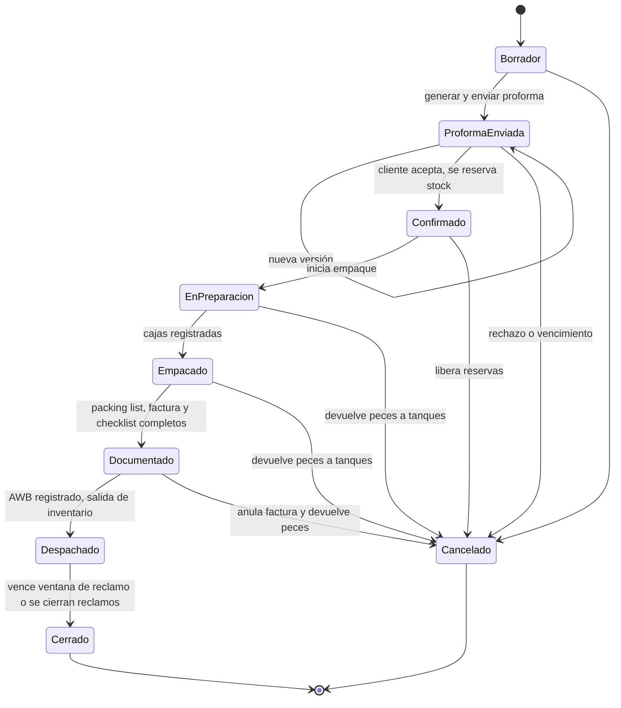
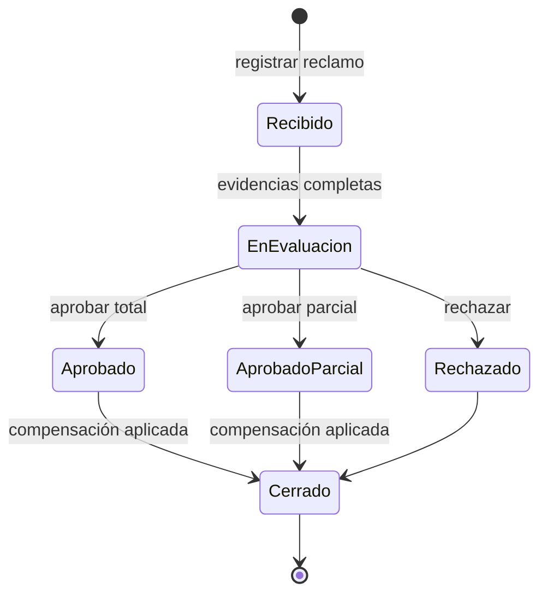

# Módulo de Exportaciones

> Estado: **diseño funcional inicial, basado en supuestos**. Los requisitos regulatorios colombianos
> (certificado zoosanitario, CITES, declaración de exportación, facturación electrónica) están marcados
> **(por validar)** y no deben tomarse como requisitos legales confirmados.

## Objetivo

Gestionar la venta de peces a clientes del exterior desde la oferta hasta el despacho y el reclamo, de forma
que la empresa:

- ofrezca solo lo que realmente tiene disponible y no venda dos veces el mismo pez;
- genere proforma, packing list y factura comercial sin retrabajo y coherentes entre sí;
- no despache sin los documentos sanitarios y CITES exigidos;
- descuente el inventario en el momento correcto y conserve la trazabilidad hasta el lote;
- atienda los reclamos DOA de los clientes con criterios claros.

## Actores

| Actor | Participación |
|---|---|
| Coordinador comercial / de exportaciones | Envía la disponibilidad, registra pedidos, genera y envía proformas, confirma, documenta y despacha. |
| Gerente / dueño | Aprueba precios especiales y reclamos; revisa márgenes. |
| Jefe de bodega / operarios | Preparan el pedido: ayuno, captura, empaque en bolsas y cajas, registro de lo realmente empacado. |
| Cliente del exterior (externo) | Recibe la disponibilidad, pide, confirma la proforma, paga, recibe y reporta DOA. |
| Agente de carga / aerolínea (externos) | Reserva el espacio, recibe las cajas en el aeropuerto, emite el AWB. |
| Autoridades (externas, **por validar**) | Certificación zoosanitaria (ICA), permisos de recursos hidrobiológicos (AUNAP), aduana (DIAN), CITES. |

## Flujo principal

1. **Lista de disponibilidad**: el sistema genera la lista (PDF) con especies y tallas disponibles
   (excluye cuarentena, bloqueados y reservado) y los precios de la lista del cliente. El coordinador la
   envía por correo a uno o varios clientes.
2. **Pedido**: el cliente responde con lo que quiere (correo, WhatsApp). El coordinador registra el pedido
   en borrador: cliente, aeropuerto destino, fecha tentativa de vuelo, incoterm y líneas (especie, talla,
   cantidad, precio).
3. **Proforma**: el sistema genera la proforma (PDF) con número y versión, condiciones de pago y validez, y
   la envía por correo al cliente. Si el cliente pide cambios, se genera una nueva versión.
4. **Confirmación y reserva**: cuando el cliente acepta (y paga el anticipo, si aplica **(por validar)**), el
   coordinador confirma el pedido y el sistema **reserva el stock** por lote. Si no alcanza, reserva lo que
   hay y marca la línea como "sin cobertura completa".
5. **Coordinación del vuelo**: el coordinador reserva el espacio con el agente de carga y registra vuelo,
   fecha y AWB provisional.
6. **Preparación y empaque**: el día del despacho, la bodega captura los peces de los tanques (se trasladan a
   la ubicación lógica "zona de empaque"), los empaca en bolsas según la densidad por especie y talla, y las
   bolsas en cajas. Se registra cada caja: número, tipo, peso y contenido (especie, talla, lote, cantidad,
   bolsas).
7. **Packing list y factura comercial**: con lo **realmente empacado**, el sistema genera el packing list y
   la factura comercial (PDF), con consecutivo.
8. **Documentos sanitarios y CITES**: el coordinador carga el certificado zoosanitario de exportación, el
   permiso CITES (si alguna especie lo requiere) y la declaración de exportación **(por validar)**. El
   sistema muestra un checklist documental del pedido.
9. **Despacho**: se entregan las cajas al agente de carga en el aeropuerto; el coordinador registra el AWB
   definitivo, vuelo, fecha y hora, cajas, peso bruto y peso cobrable, y carga la guía. Al confirmar el
   despacho, el sistema registra la **salida de inventario** (consume las reservas y descuenta las
   existencias de la zona de empaque).
10. **Envío de documentos al cliente**: el sistema envía por correo packing list, factura comercial, AWB y
    certificados.
11. **Reclamo DOA del cliente**: si el cliente reporta DOA dentro de su ventana, el coordinador registra el
    reclamo con evidencia; el gerente lo aprueba total o parcialmente o lo rechaza, y se define la
    compensación (nota crédito, descuento en el próximo pedido, reposición).
12. **Cierre**: el pedido se cierra cuando vence la ventana de reclamo sin reclamos o cuando se cierran los
    reclamos.

## Entidades

| Entidad | Campos clave | Notas |
|---|---|---|
| Pedido | id, consecutivo, cliente, moneda, incoterm, aeropuerto destino, fecha tentativa de vuelo, estado, condiciones de pago, total, creado por | Consecutivo `PD-AAAA-NNNN`. |
| LineaPedido | pedido, especie, talla, cantidad pedida, cantidad reservada, cantidad empacada, precio unitario, precio de lista, descuento, aprobación de precio | |
| Proforma | id, consecutivo, pedido, versión, fecha, validez hasta, total, archivo PDF, enviada a, fecha de envío, vigente (sí/no) | Una versión vigente por pedido. Consecutivo `PF-AAAA-NNNN`. |
| Reserva | lote, línea de pedido, cantidad, estado | Vive en Inventario. |
| Caja | id, pedido, número de caja, tipo de caja, peso bruto, dimensiones, peso volumétrico | |
| ContenidoCaja | caja, línea de pedido, lote, tanque de origen, cantidad, número de bolsas | Trazabilidad caja → lote. |
| FacturaComercial | id, consecutivo, pedido, fecha, total, estado (emitida, anulada), archivo PDF | Consecutivo propio; relación con factura electrónica DIAN **(por validar)**. |
| PackingList | id, consecutivo, pedido, fecha, total cajas, peso bruto, peso neto, archivo PDF | |
| DocumentoExportacion | id, pedido, tipo, número, fecha, vencimiento, archivo (S3), cargado por | Tipos: certificado zoosanitario, CITES, AWB, declaración de exportación, otros. |
| Despacho | id, pedido, AWB, agente de carga, aerolínea, vuelo, fecha y hora de salida, llegada estimada, llegada real, cajas, peso bruto, peso cobrable, despachado por | |
| ReclamoCliente | id, consecutivo, pedido, fecha de reporte, fecha límite, estado, monto reclamado, monto aprobado, compensación, evidencias, registrado por, aprobado por | |
| LineaReclamoCliente | reclamo, línea de pedido, lote, motivo (DOA, faltante, especie o talla errada), cantidad, valor | Permite medir el DOA por lote y por proveedor de origen. |
| Cliente / ListaPrecios (catálogo) | país, aeropuerto destino, moneda, incoterm, lista de precios, ventana de reclamo (horas), documentos exigidos, correo(s) | Definidos en Catálogos. |
| DensidadEmpaque (catálogo) | especie, talla, máximo de piezas por bolsa, bolsas por caja sugeridas | |

## Estados

### Pedido

Si el vuelo se cancela después del empaque, el pedido puede volver a *Confirmado* (devolviendo los peces a
tanques) o reprogramarse manteniendo el estado **(por validar)**.

### Reclamo del cliente

## Reglas de negocio

1. **Disponibilidad**: solo se ofrece stock de lotes *Disponibles* menos lo reservado. Lotes en cuarentena
   o bloqueados nunca aparecen en la lista de disponibilidad ni en la proforma.
2. **Precios**: el precio sugerido sale de la lista de precios del cliente. Un precio por debajo de la
   lista (o un descuento mayor a un porcentaje configurable) requiere `exportaciones:aprobar-precio` antes
   de enviar la proforma.
3. **Proforma**: tiene validez configurable (p. ej. 48 horas **(por validar)**). Cada cambio genera una
   nueva versión; solo la versión vigente se puede confirmar. La proforma no reserva stock.
4. **Reserva al confirmar**: al confirmar el pedido se reserva stock por lote, sugiriendo los lotes más
   antiguos primero. No se puede reservar más que lo disponible; las líneas sin cobertura completa quedan
   marcadas y el coordinador decide si confirma parcial o espera.
5. **Vencimiento de reservas**: si un pedido confirmado no se despacha en la fecha de vuelo + N días
   (configurable), se genera una alerta; la liberación de la reserva es manual (cancelar o reprogramar).
6. **Cancelación**: cancelar un pedido libera sus reservas; si ya estaba empacado, los peces regresan a
   tanques mediante traslado. Un pedido *Despachado* no se puede cancelar.
7. **Densidad por bolsa**: el sistema sugiere el número de bolsas según la densidad máxima por especie y
   talla y advierte si se supera; superarla exige registrar una justificación.
8. **Empaque real manda**: el packing list y la factura comercial se generan con lo **empacado**, no con
   lo pedido. Si se empaca menos de lo reservado, la diferencia de reserva se libera y se informa al
   cliente. No se puede empacar más de lo reservado sin ampliar antes la reserva.
9. **Coherencia documental**: packing list y factura comercial salen del mismo empaque y deben coincidir
   en especies, tallas y cantidades. Si se modifica el empaque después de generarlos, ambos se regeneran.
10. **Factura inmutable**: una factura comercial emitida no se edita; se anula y se emite una nueva con otro
    consecutivo. La relación con la factura electrónica de la DIAN está **(por validar)**.
11. **Checklist documental para despachar**: no se puede registrar el despacho sin packing list, factura
    comercial, AWB y certificado zoosanitario; y sin permiso CITES cuando alguna especie del pedido está
    marcada como CITES. La lista exacta es configurable por país destino y cliente **(por validar)**.
12. **Movimientos de inventario**: el empaque traslada los peces del tanque a la zona de empaque (siguen en
    inventario); el despacho registra la salida desde la zona de empaque y consume las reservas. Así, un
    vuelo cancelado no deja el inventario descuadrado.
13. **Peso cobrable**: peso cobrable = mayor entre peso bruto y peso volumétrico (factor **por validar** con
    el agente de carga); es informativo para estimar el flete.
14. **Ventana de reclamo del cliente**: configurable por cliente en horas desde la llegada del vuelo
    (valor típico **por validar**, p. ej. 24 horas). Un reclamo fuera de la ventana solo se registra con
    justificación y se marca como extemporáneo.
15. **Reclamo**: exige evidencia (fotos). La cantidad reclamada por línea no puede superar lo despachado.
    Quien aprueba (`exportaciones:aprobar-reclamo`) debe ser distinto de quien registró. El reclamo no
    devuelve unidades al inventario (los peces ya salieron).
16. **Trazabilidad**: cada línea de reclamo se asocia al lote despachado, para medir el DOA por lote, por
    especie y por proveedor de origen.
17. **Moneda**: el pedido conserva la moneda del cliente (normalmente USD); los reportes en COP usan la TRM
    definida por el negocio **(por validar)**.

## Permisos

| Código | Descripción |
|---|---|
| `exportaciones:leer` | Consultar pedidos, proformas, despachos y reclamos |
| `exportaciones:cotizar` | Generar y enviar listas de disponibilidad, crear pedidos, generar y enviar proformas |
| `exportaciones:aprobar-precio` | Aprobar precios por debajo de la lista o descuentos especiales |
| `exportaciones:confirmar` | Confirmar pedidos (reserva stock), reprogramar y cancelar (libera reservas) |
| `exportaciones:empacar` | Registrar preparación y empaque: cajas, bolsas, cantidades y lotes |
| `exportaciones:documentar` | Generar packing list y factura comercial; cargar certificados, CITES, AWB y declaración |
| `exportaciones:despachar` | Registrar el despacho y la salida de inventario; enviar documentos al cliente |
| `exportaciones:reclamar` | Registrar reclamos DOA del cliente y sus evidencias |
| `exportaciones:aprobar-reclamo` | Aprobar, aprobar parcialmente o rechazar reclamos y definir la compensación |

## Documentos y PDFs

| Documento | Tipo | Notas |
|---|---|---|
| Lista de disponibilidad | PDF generado | Por cliente (con sus precios) o general; se envía por correo. |
| Proforma | PDF generado | Versionada; se envía por correo. |
| Packing list | PDF generado | Por caja: especie (nombre científico y común), talla, cantidad, bolsas, pesos. |
| Factura comercial | PDF generado | Consecutivo propio; incoterm, moneda, totales. |
| Etiquetas de caja | PDF generado (opcional) | Número de caja, cliente, destino, AWB, "LIVE TROPICAL FISH" **(por validar)**. |
| Certificado zoosanitario de exportación | Archivo cargado (S3) | **(por validar)** entidad emisora. |
| Permiso CITES de exportación | Archivo cargado (S3) | Solo si alguna especie lo requiere. |
| AWB | Archivo cargado (S3) | |
| Declaración de exportación | Archivo cargado (S3) | **(por validar)** |
| Fotos de reclamo del cliente | Archivo cargado (S3) | JPG/PNG/WEBP, máx. 10 MB; también PDF del cliente. |

## Integraciones

- **Inventario**: disponibilidad, creación y liberación de reservas, traslado a la zona de empaque, salida
  al despachar, trazabilidad por lote.
- **Catálogos**: clientes, listas de precios, especies (indicador CITES), tallas, densidad de empaque, tipos
  de caja, aeropuertos, agentes de carga.
- **Correo**: envío de lista de disponibilidad, proforma y documentos de despacho; alertas.
- **Archivos (S3)**, **PDF (QuestPDF)**, **Auditoría**.
- **Futuro (fuera de alcance)**: facturación electrónica DIAN, portal del cliente para ver disponibilidad y
  pedir, seguimiento del AWB con la aerolínea, gestión de cartera y pagos.

## Preguntas abiertas

1. ¿Cuántos clientes activos hay, en qué países, y con qué frecuencia piden?
2. ¿Cómo se envía hoy la disponibilidad (Excel, PDF, WhatsApp) y con qué frecuencia se actualiza?
3. ¿Cada cliente tiene su propia lista de precios? ¿Quién puede dar descuentos?
4. ¿Cuánto tiempo es válida una proforma? ¿Se exige anticipo o pago total antes de despachar? ¿Hay clientes
   con crédito?
5. ¿Qué incoterms se negocian con los clientes y en qué moneda se factura?
6. ¿Qué documentos exige cada país destino (certificado sanitario, CITES, otros) y quién los tramita?
   ¿Cuánto tiempo antes del vuelo deben estar listos?
7. ¿Cómo se relaciona la factura comercial con la factura electrónica que se emite ante la DIAN? ¿Quién la
   emite hoy y con qué software?
8. ¿Cuál es la densidad por bolsa que usan para cada especie y talla? ¿Está documentada?
9. ¿Qué pasa cuando al empacar no se completa la cantidad pedida: se informa antes o después de despachar?
10. ¿Qué ventana de reclamo se da a los clientes y qué evidencia exigen (fotos, video)? ¿Cómo compensan?
11. ¿Qué pasa si el vuelo se cancela o se retrasa con los peces ya empacados?
12. ¿Hay ventas locales que deban seguir un flujo simplificado (sin documentos de exportación)?
