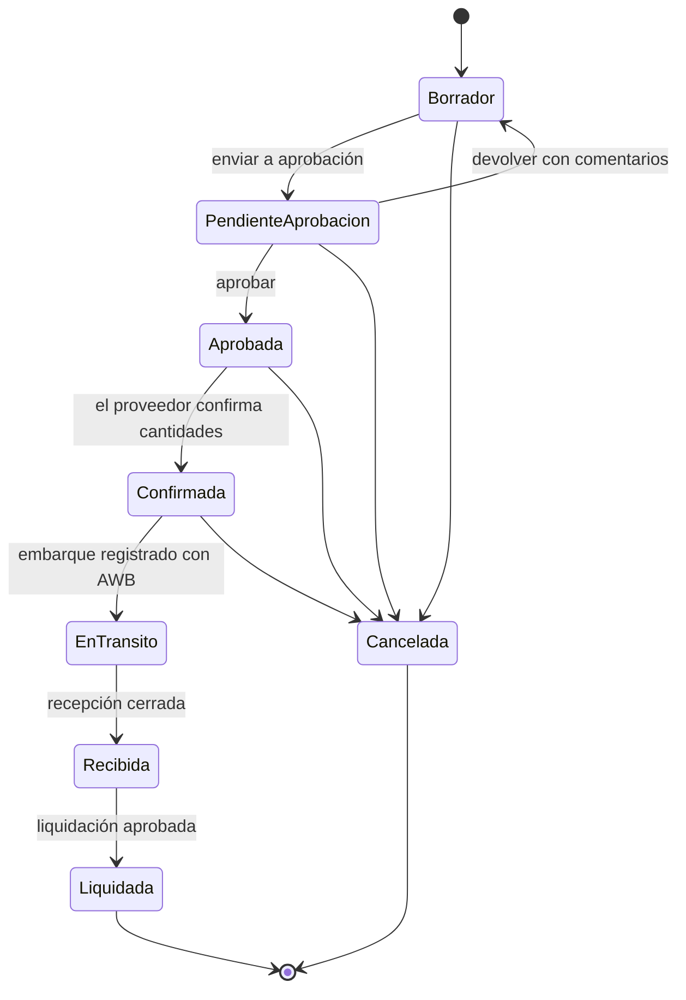
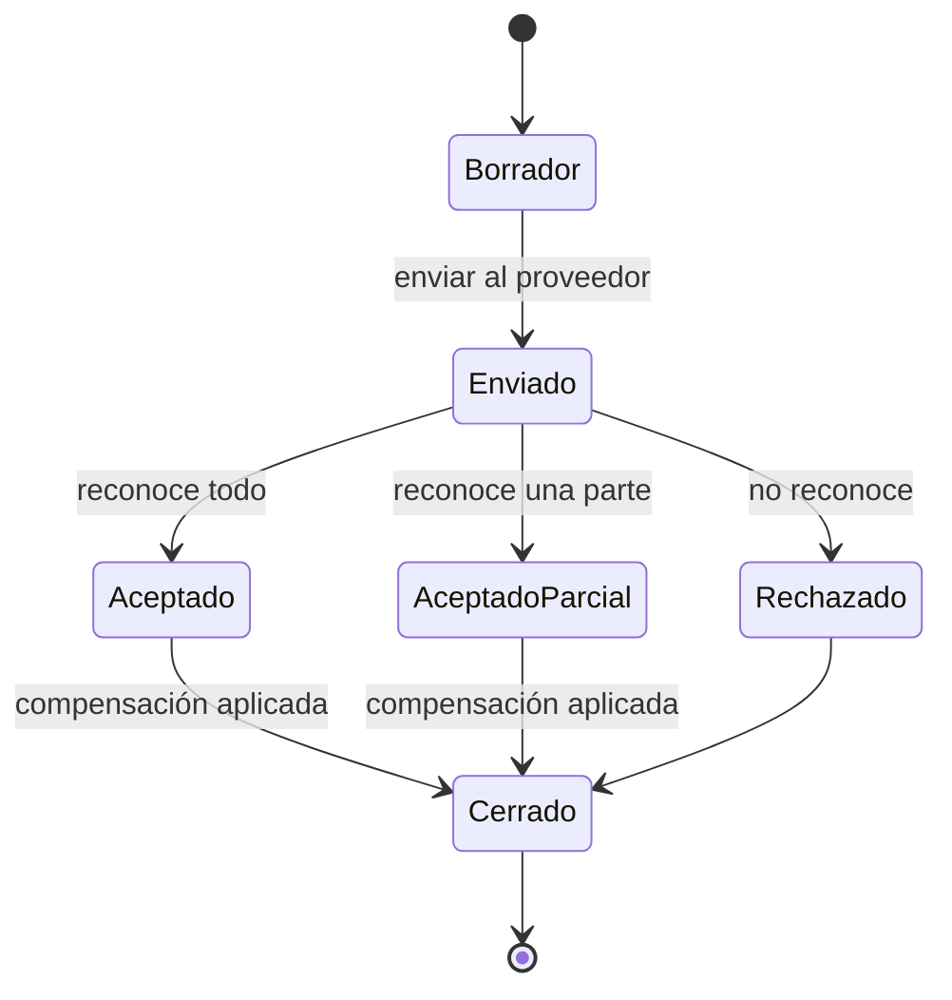

# Módulo de Importaciones

> Estado: **diseño funcional inicial, basado en supuestos**. Los requisitos regulatorios colombianos (ICA,
> AUNAP, DIAN, CITES, VUCE) están marcados **(por validar)** y no deben tomarse como requisitos legales
> confirmados.

## Objetivo

Gestionar la compra de peces a proveedores del exterior desde la orden de compra hasta que los lotes quedan
disponibles para la venta, de forma que la empresa:

- tenga todos los documentos de cada importación en un solo lugar;
- reciba con un conteo formal (vivos, DOA, faltantes) y un acta que sirva de evidencia;
- reclame a tiempo los DOA al proveedor;
- conozca el **costo landed real** de cada lote.

## Actores

| Actor | Participación |
|---|---|
| Coordinador de importaciones (comercio exterior) | Crea la orden de compra, gestiona documentos y embarque, registra costos, gestiona reclamos. |
| Gerente / dueño | Aprueba órdenes de compra y la liquidación de costos. |
| Jefe de bodega / operarios | Reciben las cajas, aclimatan, cuentan vivos y DOA, toman fotos, ubican el lote en cuarentena. |
| Proveedor del exterior (externo) | Confirma la orden, envía proforma, factura, packing list, certificados, CITES y AWB; atiende reclamos. |
| Agente de carga / agente de aduanas (externos) | Coordinan el vuelo, la nacionalización y la entrega en bodega; facturan sus servicios. |
| Autoridades (externas, **por validar**) | Inspección sanitaria (ICA), permisos de recursos hidrobiológicos (AUNAP), aduana (DIAN), CITES. |

## Flujo principal

1. **Orden de compra (borrador)**: el coordinador crea la OC con proveedor, moneda, incoterm, aeropuerto de
   origen, fecha estimada de embarque y líneas (especie, talla, cantidad, precio unitario).
2. **Validaciones previas**: el sistema marca las especies que requieren CITES (según catálogo) o permisos
   previos **(por validar)** y muestra la lista de documentos que se van a exigir.
3. **Aprobación**: el gerente aprueba la OC. Opcionalmente se genera el PDF de la OC y se envía al proveedor
   por correo.
4. **Confirmación del proveedor**: el proveedor responde con su proforma y las cantidades que puede
   despachar. El coordinador registra las cantidades confirmadas y carga la proforma del proveedor.
5. **Embarque**: el proveedor envía factura comercial, packing list, certificado sanitario de origen,
   permiso CITES de exportación (si aplica) y AWB. El coordinador registra el embarque (número de AWB,
   aerolínea, vuelo, fecha y hora estimada de llegada, número de cajas, peso) y carga los documentos.
6. **Llegada y nacionalización**: el agente de aduanas y la autoridad sanitaria liberan la carga en el
   aeropuerto. Se registran fecha y hora de llegada real y de liberación, y se cargan la declaración de
   importación y el certificado de inspección **(por validar)**.
7. **Recepción en bodega**: los operarios reciben las cajas y, tras la aclimatación, cuentan por línea:
   vivos, DOA, faltantes, sobrantes y especie o talla errada. Toman fotos de los DOA.
8. **Cierre de recepción**: el jefe de bodega revisa y cierra la recepción. El sistema genera el **acta de
   recepción (PDF)** y crea un lote por línea con las unidades vivas, en estado *En cuarentena*, ubicado en
   tanques de cuarentena, con costo provisional.
9. **Reclamo DOA**: si hay DOA, faltantes o errores, el coordinador crea el reclamo dentro de la ventana del
   proveedor, adjunta el acta y las fotos, y lo envía por correo. Se hace seguimiento hasta su resolución
   (nota crédito, reposición o rechazo).
10. **Cuarentena**: el lote sigue en Inventario; la mortalidad durante la cuarentena se registra allí.
    Cumplido el periodo, se libera a *Disponible*.
11. **Costeo**: el coordinador registra los costos de nacionalización (flete, agente de carga, aranceles,
    agencia de aduanas, tasas aeroportuarias, inspección sanitaria, transporte a bodega, otros) con su
    soporte y ejecuta el prorrateo.
12. **Liquidación**: el gerente aprueba la liquidación; el costo de cada lote pasa de provisional a
    definitivo y la importación queda *Cerrada*.

## Costeo y prorrateo

**Fórmula por defecto** (cada componente está **por validar** con el negocio y el contador):

```text
Costo línea          = valor FOB de la línea + costos adicionales prorrateados a la línea
                       − créditos de reclamo aprobados para la línea
Costo unitario lote  = Costo línea / unidades vivas recibidas en la línea
```

- **Base de prorrateo**: se define por concepto de costo. Por defecto, por valor FOB; el flete puede
  prorratearse por cajas o por peso si se registra el contenido de cada caja.
- **DOA**: el costo de los DOA se absorbe en las unidades vivas (por eso se divide por vivos, no por
  facturados), salvo lo que el proveedor reconozca en el reclamo.
- **Moneda**: cada costo se registra en su moneda; la conversión a COP usa la TRM de la fecha que defina el
  negocio (fecha de la declaración de importación o fecha de pago) **(por validar)**.
- **Impuestos**: el IVA de importación probablemente es descontable y no hace parte del costo; los aranceles
  sí **(por validar con el contador)**.

**Ejemplo** (USD, prorrateo por valor FOB):

| Línea | Piezas facturadas | Precio FOB | Valor FOB | % FOB | Costos adicionales (700) | DOA | Vivos | Costo unitario |
|---|---|---|---|---|---|---|---|---|
| A — Especie X, talla M | 500 | 0,80 | 400,00 | 40 % | 280,00 | 20 | 480 | (400 + 280) / 480 = **1,42** |
| B — Especie Y, talla L | 200 | 3,00 | 600,00 | 60 % | 420,00 | 5 | 195 | (600 + 420) / 195 = **5,23** |

Costos adicionales del ejemplo: flete 500 + agencia y tasas 200 = 700.

## Entidades

| Entidad | Campos clave | Notas |
|---|---|---|
| OrdenCompra | id, consecutivo, proveedor, moneda, incoterm, aeropuerto origen, fecha estimada de embarque, estado, creada por, aprobada por, total | Consecutivo `OC-AAAA-NNNN`. |
| LineaOrdenCompra | orden, especie, talla, cantidad pedida, cantidad confirmada, precio unitario | La talla del proveedor puede diferir de la propia: guardar ambas **(por validar)**. |
| Embarque | id, orden(es), número AWB, aerolínea, vuelo, aeropuerto destino, ETA, llegada real, liberación, cajas, peso bruto, peso cobrable, estado | Una OC puede tener varios embarques. |
| DocumentoImportacion | id, orden o embarque, tipo, número, fecha, vencimiento, archivo (S3), cargado por | Tipos: proforma, factura comercial, packing list, certificado sanitario, CITES, AWB, declaración de importación, otros. |
| Recepcion | id, embarque, fecha y hora de inicio y cierre, recibió, cerró, estado, observaciones, acta (PDF) | Una por embarque. |
| LineaRecepcion | recepción, línea de OC, especie, talla, facturadas, vivas, DOA, faltantes, sobrantes, tanque destino, lote generado | Fotos de DOA asociadas. |
| CostoImportacion | id, orden, concepto, tercero, moneda, monto, TRM, base de prorrateo, soporte (archivo), estado | Concepto del catálogo ConceptoCosto. |
| Liquidacion | id, orden, fecha, total FOB, total costos, detalle por línea (asignado, costo unitario), aprobada por, estado | Al aprobarse fija el costo de los lotes. |
| ReclamoProveedor | id, consecutivo, proveedor, recepción, fecha, fecha límite, estado, monto reclamado, monto reconocido, tipo de compensación, evidencias | Tipos de compensación: nota crédito, reposición en próximo envío, ninguna. |
| LineaReclamoProveedor | reclamo, línea de recepción, motivo (DOA, faltante, especie errada, talla errada, DOA extendido), cantidad, valor | |
| Proveedor (catálogo) | país, moneda, incoterm por defecto, ventana de reclamo (horas), contacto, correo, documentos exigidos | Definido en Catálogos. |

## Estados

### Orden de compra



Si una OC llega en varios embarques, pasa a *Recibida* cuando se cierra la última recepción (o se marca
el saldo como no despachado).

### Reclamo al proveedor



## Reglas de negocio

1. Una OC requiere proveedor activo y al menos una línea con especie y talla del catálogo, cantidad entera
   mayor que cero y precio mayor o igual a cero.
2. Una OC no se puede enviar al proveedor ni registrar embarques sin estar *Aprobada*. Quien aprueba debe
   ser distinto de quien la creó **(por validar: en una empresa pequeña el dueño podría hacer ambas cosas;
   dejarlo configurable)**.
3. Si después de aprobada la OC el total aumenta más de un porcentaje configurable (p. ej. 10 %), vuelve a
   *PendienteAprobacion*. Toda modificación queda auditada.
4. **La recepción nunca se bloquea por documentos faltantes**: son animales vivos y deben recibirse y
   aclimatarse de inmediato. Lo que se bloquea es la **liberación de cuarentena** de los lotes y la
   **liquidación** mientras falten documentos obligatorios.
5. **Documentos obligatorios** por defecto: factura comercial, packing list, AWB y certificado sanitario de
   origen; permiso CITES de exportación del país de origen (y de importación, si aplica) cuando alguna
   especie de la OC esté marcada como CITES en el catálogo; declaración de importación **(por validar)**.
   La lista exacta es configurable por proveedor y país.
6. **Cuadre de recepción** por línea: vivas + DOA + faltantes = facturadas en el packing list. Los
   sobrantes se registran aparte. El sistema no deja cerrar la recepción si no cuadra.
7. **DOA no es mortalidad de inventario**: los DOA se registran en la recepción y nunca entran al
   inventario. La mortalidad posterior al cierre de la recepción se registra en Inventario y se mide
   aparte.
8. Al **cerrar la recepción** se genera el acta (PDF) y un lote por línea con las unidades vivas, en estado
   *En cuarentena*, con origen = esta importación y **costo provisional** = precio FOB × facturadas /
   vivas. Después del cierre, las cantidades solo se corrigen con ajustes de inventario aprobados.
9. **Ventana de reclamo**: cada proveedor tiene una ventana en horas contadas desde la llegada real del
   vuelo (valor típico **por validar**, p. ej. 24 a 48 horas). El sistema muestra la fecha límite desde que
   se registra la llegada y alerta antes de que venza. Crear un reclamo fuera de la ventana exige
   justificación.
10. Un reclamo exige evidencia (fotos y/o acta de recepción). La cantidad reclamada por línea no puede
    superar DOA + faltantes + errores registrados en la recepción, más la mortalidad en cuarentena
    imputable al proveedor dentro de la ventana (DOA extendido, solo si el proveedor lo acepta).
11. Los créditos reconocidos en reclamos cerrados antes de la liquidación reducen el costo de la línea. Los
    reconocidos después se registran como ajuste de costo **(por validar contablemente)**.
12. Cada costo de nacionalización exige concepto, moneda, monto, TRM (si no es COP) y soporte cargado.
13. La liquidación solo se aprueba con la recepción cerrada, los documentos obligatorios completos y todos
    los costos registrados. Al aprobarla, el costo de los lotes pasa a definitivo y los costos quedan
    bloqueados; reabrirla requiere `importaciones:liquidar` y justificación.
14. Si unidades del lote ya salieron antes de la liquidación, la diferencia entre costo provisional y
    definitivo de esas unidades se reporta como ajuste de costo de ventas **(por validar con el
    contador)**.
15. Los sobrantes (peces extra enviados por el proveedor) entran como un lote separado o se suman a la
    línea con costo FOB cero, pero reciben costos prorrateados por cantidad **(por validar)**.

## Permisos

| Código | Descripción |
|---|---|
| `importaciones:leer` | Consultar órdenes de compra, embarques, recepciones, costos y reclamos |
| `importaciones:gestionar` | Crear y editar órdenes de compra, registrar confirmaciones y embarques, cargar documentos |
| `importaciones:aprobar` | Aprobar o devolver órdenes de compra |
| `importaciones:recibir` | Registrar la recepción física: conteo de vivos, DOA, faltantes, fotos |
| `importaciones:cerrar-recepcion` | Cerrar la recepción, generar el acta y crear los lotes en cuarentena |
| `importaciones:costear` | Registrar costos de nacionalización y ejecutar el prorrateo |
| `importaciones:liquidar` | Aprobar o reabrir la liquidación y cerrar la importación |
| `importaciones:reclamar` | Crear, enviar y cerrar reclamos al proveedor |

La liberación de cuarentena usa `inventario:liberar-cuarentena` (módulo de Inventario).

## Documentos y PDFs

| Documento | Tipo | Notas |
|---|---|---|
| Orden de compra | PDF generado (opcional) | Para enviar al proveedor por correo. |
| Acta de recepción | PDF generado | Al cerrar la recepción: cajas, líneas, vivos, DOA, faltantes, sobrantes, responsables, fecha y hora. |
| Liquidación de costos | PDF generado | Detalle de costos, base de prorrateo y costo unitario por lote. |
| Reclamo al proveedor | PDF generado | Detalle por línea, fotos referenciadas y monto reclamado; se envía por correo. |
| Proforma del proveedor, factura comercial, packing list, AWB | Archivo cargado (S3) | PDF/JPG/PNG/WEBP, máx. 10 MB. |
| Certificado sanitario de origen, permiso CITES | Archivo cargado (S3) | Con número y fecha de vencimiento cuando aplique. |
| Declaración de importación, certificado de inspección | Archivo cargado (S3) | **(por validar)** |
| Facturas de costos (flete, agencia, tasas) | Archivo cargado (S3) | Soporte obligatorio de cada costo. |
| Fotos de DOA | Archivo cargado (S3) | JPG/PNG/WEBP. |

## Integraciones

- **Inventario**: crea los lotes en cuarentena al cerrar la recepción; actualiza el costo al liquidar;
  lee la mortalidad en cuarentena para el reclamo.
- **Catálogos**: proveedores, especies (indicador CITES, días de cuarentena), tallas, tanques, conceptos de
  costo, aeropuertos, aerolíneas.
- **Correo**: envío de la OC y del reclamo al proveedor; alertas de vencimiento de la ventana de reclamo.
- **Archivos (S3)**, **PDF (QuestPDF)**, **Auditoría**.
- **Futuro (fuera de alcance)**: consulta automática de la TRM; seguimiento del AWB con la aerolínea;
  integración con el software contable.

## Preguntas abiertas

1. ¿De qué países y cuántos proveedores se importa? ¿Con qué frecuencia llegan embarques?
2. ¿Qué incoterms se usan en la práctica y en qué moneda se paga?
3. ¿Qué permisos previos y certificados exigen hoy las autoridades para importar peces ornamentales
   (ICA, AUNAP, MinAmbiente/CITES, VUCE)? ¿Quién los tramita: la empresa o la agencia de aduanas?
4. ¿Cuál es la ventana de reclamo de cada proveedor y qué evidencia exige (fotos, video, acta)? Si exigen
   video, hay que ampliar los formatos de archivo permitidos (hoy solo PDF/JPG/PNG/WEBP).
5. ¿Los proveedores aceptan reclamos por mortalidad en los primeros días (DOA extendido)?
6. ¿Cómo compensan los proveedores: nota crédito, reposición, descuento en la siguiente factura?
7. ¿Qué costos se incluyen hoy en el costo de un pez importado y cómo se reparten? ¿El flete se reparte por
   valor, por cajas o por peso?
8. ¿Qué TRM se usa para costear: la de la declaración de importación o la del pago?
9. ¿Se reciben todos los peces de un embarque en un solo momento, o hay recepciones parciales?
10. ¿Los proveedores usan las mismas tallas que JR Tropical Fish, o hay que mapear tallas?
11. ¿Quién aprueba hoy una compra y la liquidación de costos?
12. ¿Se compra también a acopiadores nacionales? ¿Ese flujo es igual (sin aduana) o distinto?
