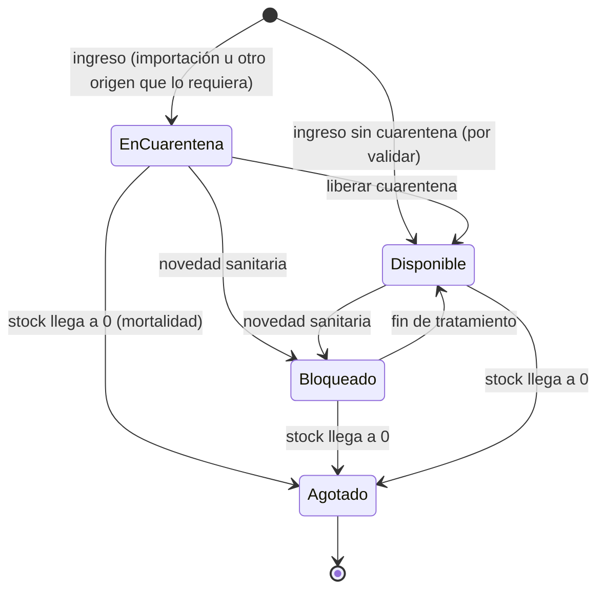
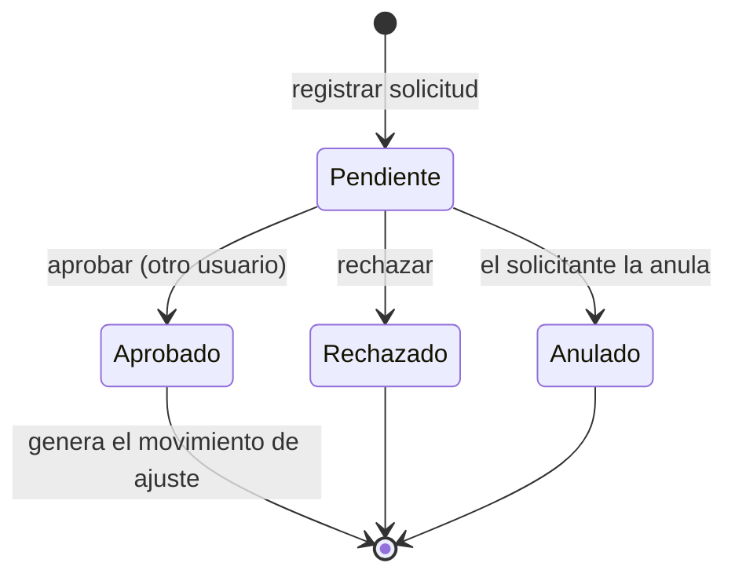
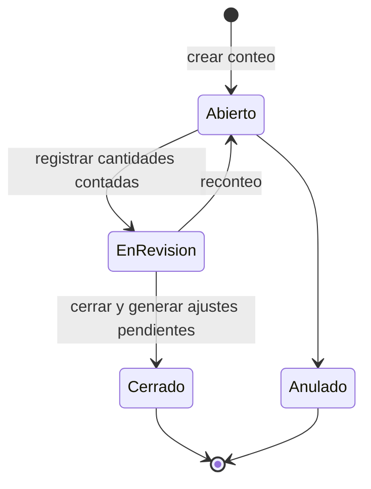

# Módulo de Inventario

> Estado: **diseño funcional inicial, basado en supuestos**. Las reglas marcadas **(por validar)** y la
> sección *Preguntas abiertas* deben revisarse con el negocio antes de construir.

## Objetivo

Saber en todo momento **cuántos peces vivos hay, de qué especie y talla, de qué lote y en qué tanque**,
cuáles se pueden vender y cuánto cuestan. Todo cambio de stock queda registrado como un movimiento con
responsable, fecha y motivo, para tener trazabilidad desde que un lote entra (importación, producción
propia, compra local) hasta que sale (exportación, venta local, mortalidad).

## Actores

| Actor | Participación |
|---|---|
| Operario de acuarios | Registra traslados, mortalidad, conteos físicos y solicitudes de ajuste, normalmente desde el celular en la bodega. |
| Jefe de bodega / acuarios | Libera o bloquea lotes de cuarentena, aprueba ajustes, cierra conteos, revisa alertas. |
| Coordinador de comercio exterior | Consulta disponibilidad para ofrecer y reservar (Exportaciones) y ve ingresar los lotes importados (Importaciones). |
| Gerente / dueño | Consulta stock valorizado, mortalidad y alertas; aprueba ajustes significativos. |
| Sistema | Calcula saldos, aplica reservas, genera alertas y PDFs. |

## Modelo de stock

El stock se maneja en tres niveles:

- **Lote**: especie + talla + origen (una línea de importación, una cosecha propia, una compra local o la
  carga inicial). Tiene estado y costo unitario.
- **Existencia**: cantidad de un lote en un tanque. Un lote puede estar repartido en varios tanques.
- **Reserva**: cantidad de un lote apartada para un pedido confirmado. Se hace a nivel de lote, no de
  tanque; el tanque se elige al empacar.

Cálculos:

- Stock físico del lote = suma de sus existencias.
- Stock disponible para vender = stock físico de lotes en estado *Disponible* − reservas activas.
- Stock por especie + talla = suma de los lotes de esa especie y talla.

## Flujo principal

1. **Ingreso de un lote**: el lote se crea por una de estas vías:
   - Cierre de una recepción de importación (automático, desde Importaciones) → estado *En cuarentena*.
   - Entrada manual por producción propia, compra local o carga inicial (`inventario:ingresar`) → estado
     *En cuarentena* o *Disponible*, según el origen **(por validar)**.
2. **Ubicación**: el lote queda en uno o varios tanques (existencias). Si llega en cuarentena, se ubica en
   tanques de tipo cuarentena.
3. **Operación diaria** mientras el lote está en bodega:
   - Traslados entre tanques (por densidad, limpieza, clasificación, preparar despacho).
   - Registro de mortalidad con causa.
   - Reclasificación de talla cuando los peces crecen.
   - Solicitudes de ajuste cuando se detecta una diferencia.
4. **Liberación de cuarentena**: cumplidos los días mínimos de la especie y sin novedades sanitarias, el
   jefe de bodega libera el lote → *Disponible*. Si hay enfermedad, lo bloquea → *Bloqueado* (en
   tratamiento).
5. **Reserva**: al confirmar un pedido de exportación, se reservan unidades de lotes disponibles.
6. **Salida**: al despachar una exportación (o registrar una venta local), se descuentan las existencias de
   los tanques usados y se consumen las reservas.
7. **Conteo físico** periódico por tanque: se registra el conteo, se comparan diferencias y al cerrar se
   generan ajustes que requieren aprobación.
8. **Alertas**: el sistema avisa sobre stock bajo, mortalidad alta, cuarentenas vencidas, reservas sin
   cobertura y diferencias de conteo.
9. Cuando el stock físico de un lote llega a cero, el lote pasa a *Agotado*.

### Tipos de movimiento

| Tipo | Efecto | Origen típico |
|---|---|---|
| Entrada por importación | + existencia, crea lote | Cierre de recepción (Importaciones) |
| Entrada por producción propia | + existencia, crea lote | Manual |
| Entrada por compra local | + existencia, crea lote | Manual **(por validar)** |
| Entrada por carga inicial | + existencia, crea lote | Migración del stock actual |
| Salida por exportación | − existencia, consume reserva | Despacho (Exportaciones) |
| Salida por venta local | − existencia | Manual **(por validar)** |
| Mortalidad | − existencia, con causa | Manual |
| Traslado | − tanque origen, + tanque destino | Manual / empaque |
| Ajuste positivo / negativo | ± existencia, tras aprobación | Solicitud de ajuste o cierre de conteo |
| Cambio de estado | Sin cambio de cantidad (cuarentena → disponible, disponible ↔ bloqueado) | Liberación / bloqueo |
| Reclasificación de talla | − lote/talla anterior, + misma cantidad en talla nueva | Manual |
| Contramovimiento | Revierte un movimiento erróneo, referenciándolo | Corrección aprobada |

## Entidades

| Entidad | Campos clave | Notas |
|---|---|---|
| Lote | id, código legible, especie, talla, origen (tipo y referencia), proveedor (si aplica), fecha de ingreso, estado, costo unitario, costo provisional (sí/no), fecha fin de cuarentena estimada | El código legible se imprime en tanques y documentos. El costo es provisional hasta la liquidación de la importación. |
| Existencia | lote, tanque, cantidad | Saldo derivado de los movimientos; se puede materializar por rendimiento, pero nunca editar a mano. |
| MovimientoInventario | id, tipo, fecha y hora, lote, tanque origen, tanque destino, cantidad, causa (mortalidad), motivo, documento de referencia (recepción, pedido, ajuste, conteo), usuario, movimiento revertido | Inmutable. |
| SolicitudAjuste | id, lote, tanque, cantidad (±), motivo, evidencia (foto), estado, solicitante, aprobador, fecha de aprobación, comentario | Solo afecta el stock al aprobarse. |
| ConteoFisico | id, tanques incluidos, fecha, estado, responsable, quién cerró | Puede abarcar uno o varios tanques. |
| LineaConteo | conteo, lote, tanque, cantidad teórica (oculta al contar), cantidad contada, diferencia | Conteo "a ciegas". |
| Reserva | id, lote, línea de pedido, cantidad, estado (activa, consumida, liberada), fecha | La crea y consume Exportaciones; vive en Inventario. |
| Alerta | id, tipo, entidad relacionada, severidad, mensaje, estado (abierta, atendida), fecha | Se puede notificar por correo. |
| ParametroInventario | especie/talla, stock mínimo, umbral de mortalidad diaria, días máximos sin conteo | Configurable con `inventario:configurar`. |
| Tanque (catálogo) | id, código, bodega, tipo (cuarentena, venta, producción, hospital, empaque), capacidad, activo | Definido en Catálogos. |
| CausaMortalidad (catálogo) | id, nombre, imputable a proveedor (sí/no) | P. ej.: enfermedad, estrés de transporte, calidad de agua, salto, depredación, desconocida. |

## Estados

### Lote

### Solicitud de ajuste

### Conteo físico

## Reglas de negocio

1. **Stock no negativo**: ninguna existencia (lote + tanque) puede quedar con cantidad negativa. Un
   movimiento que lo provoque se rechaza.
2. **Todo cambio es un movimiento**: no se editan saldos directamente. Los movimientos son inmutables; un
   error se corrige con un contramovimiento que referencia al original, con motivo y permiso de ajuste.
3. **Cantidades enteras**: todas las cantidades son unidades (piezas) enteras mayores que cero.
4. **Mortalidad**: es un movimiento de salida con **causa obligatoria** (catálogo), lote, tanque, cantidad
   y fecha; la foto es opcional. Se registra de inmediato, sin aprobación, porque refleja un hecho físico,
   pero queda auditada.
5. **Mortalidad y reservas**: la mortalidad nunca se bloquea por existir reservas. Si después de registrarla
   el stock físico del lote queda por debajo de lo reservado, se genera una alerta de **reserva sin
   cobertura** para el coordinador comercial.
6. **Mortalidad en cuarentena**: se registra igual que cualquier mortalidad, pero queda identificada para
   el indicador de calidad del proveedor. Si la causa es "imputable a proveedor" y está dentro de la ventana
   de reclamo, el sistema lo sugiere como candidato a reclamo (ver Importaciones).
7. **Lotes en cuarentena o bloqueados no se venden**: no aparecen en la lista de disponibilidad, no se
   pueden reservar ni despachar.
8. **Liberación de cuarentena**: requiere `inventario:liberar-cuarentena`. Por defecto exige haber cumplido
   los días mínimos de cuarentena de la especie (parámetro del catálogo; valor por defecto **por validar**,
   p. ej. 7 a 14 días). Una liberación anticipada exige justificación escrita.
9. **Documentos para liberar**: un lote importado no se puede liberar si la importación no tiene cargados los
   documentos obligatorios (ver Importaciones, regla de documentos).
10. **Ajustes con aprobación**: una solicitud de ajuste no afecta el stock hasta ser aprobada. Quien aprueba
    debe ser un usuario distinto de quien la registró. Requiere motivo; la evidencia es opcional.
11. **Traslados**: el tanque destino debe ser distinto del origen y estar activo; la cantidad no puede
    superar la existencia en el origen. El traslado no cambia el lote, el costo ni el estado.
12. **Cuarentena y tipo de tanque**: un lote en cuarentena solo puede estar en tanques de tipo cuarentena u
    hospital; trasladarlo a un tanque de venta exige liberarlo primero **(por validar)**.
13. **Reclasificación de talla**: conserva el lote de origen (trazabilidad) y el costo unitario. Se
    registra como un par de movimientos (salida de la talla anterior, entrada a la nueva) bajo una misma
    operación.
14. **Reserva**: solo sobre lotes *Disponibles* y hasta el stock disponible. El sistema sugiere los lotes
    más antiguos primero (FIFO) **(por validar)**; el usuario puede elegir otro lote.
15. **Costo del lote**: cada lote tiene un costo unitario. Importación: costo landed (provisional hasta la
    liquidación). Producción propia y compra local: costo ingresado manualmente o estándar **(por
    validar)**. La mortalidad no modifica el costo unitario de los sobrevivientes; su valor se reporta como
    pérdida **(por validar con el contador)**.
16. **Valorización**: el inventario se valoriza por identificación específica (cantidad × costo unitario
    de cada lote). Solo la ven usuarios con `inventario:ver-costos`.
17. **Conteo físico a ciegas**: quien cuenta no ve la cantidad teórica. Mientras un conteo está *Abierto* o
    *En revisión*, se bloquean traslados hacia y desde los tanques incluidos, salvo mortalidad (que se
    descuenta del teórico).
18. **Cierre de conteo**: genera una solicitud de ajuste por cada diferencia; esas solicitudes siguen la
    regla 10.
19. **Fechas**: un movimiento no puede tener fecha futura. Registrar con más de 48 horas de atraso requiere
    justificación **(por validar el plazo)**.
20. **Alertas**:
    - Stock disponible de una especie + talla por debajo del mínimo configurado.
    - Mortalidad diaria de un lote o tanque por encima del umbral (porcentaje configurable).
    - Lote en cuarentena que superó los días previstos sin liberarse.
    - Reserva sin cobertura (regla 5).
    - Diferencia de conteo por encima del umbral.
    - Tanque sin conteo físico en más de N días.

## Permisos

| Código | Descripción |
|---|---|
| `inventario:leer` | Consultar stock, lotes, tanques, movimientos y alertas (sin costos) |
| `inventario:ver-costos` | Ver costos unitarios y valorización |
| `inventario:ingresar` | Registrar entradas manuales (producción propia, compra local, carga inicial) |
| `inventario:trasladar` | Registrar traslados entre tanques |
| `inventario:registrar-mortalidad` | Registrar mortalidad con causa |
| `inventario:reclasificar` | Registrar reclasificación de talla |
| `inventario:ajustar` | Registrar solicitudes de ajuste |
| `inventario:aprobar-ajuste` | Aprobar o rechazar solicitudes de ajuste |
| `inventario:liberar-cuarentena` | Liberar lotes de cuarentena y bloquear/desbloquear lotes |
| `inventario:contar` | Crear conteos y registrar cantidades contadas |
| `inventario:cerrar-conteo` | Cerrar conteos y generar ajustes |
| `inventario:configurar` | Configurar stock mínimo, umbrales y alertas |

## Documentos y PDFs

| Documento | Tipo | Notas |
|---|---|---|
| Reporte de existencias | PDF generado | Por bodega, tanque, especie y talla; con o sin costos según permiso. |
| Inventario valorizado | PDF generado | Requiere `inventario:ver-costos`. |
| Kardex por lote | PDF generado | Todos los movimientos de un lote, de su ingreso a su salida. |
| Reporte de mortalidad | PDF generado | Por periodo, causa, especie, tanque y proveedor de origen. |
| Acta de conteo físico | PDF generado | Teórico, contado, diferencias, responsables. |
| Fotos de mortalidad / evidencia de ajuste | Archivo cargado (S3) | JPG, PNG o WEBP, máx. 10 MB. |

## Integraciones

- **Catálogos**: especies, tallas, tanques, causas de mortalidad, parámetros de cuarentena.
- **Importaciones**: crea lotes en cuarentena al cerrar una recepción; actualiza el costo del lote al
  liquidar; consulta la mortalidad en cuarentena para reclamos.
- **Exportaciones**: consulta disponibilidad, crea y libera reservas, traslada a la zona de empaque y
  registra la salida al despachar.
- **Seguridad y auditoría**: permisos y registro de cada cambio.
- **Archivos (S3)**: fotos y evidencias.
- **PDF (QuestPDF)**: reportes listados arriba.
- **Correo**: envío de alertas a los responsables.
- **Futuro (fuera de alcance)**: sensores de calidad de agua (temperatura, pH, amonio) por tanque.

## Preguntas abiertas

1. ¿Cómo se identifica hoy un lote en la bodega (etiqueta en el tanque, código del proveedor, fecha)?
2. ¿Se mezclan en un mismo tanque peces de la misma especie y talla de lotes distintos? Si es así, ¿se
   acepta perder la trazabilidad por lote (fusión de lotes) o hay que separarlos?
3. ¿Cuál es la escala de tallas: S/M/L/XL por especie, centímetros, o ambas?
4. ¿Cuántos días de cuarentena se aplican y varían por especie u origen? ¿Los lotes de producción propia
   pasan por cuarentena?
5. ¿Quién decide liberar una cuarentena? ¿Hay un veterinario o biólogo responsable?
6. ¿Cómo se cuenta un tanque con cientos de peces pequeños: conteo exacto, estimación por muestreo o por
   peso? Si es estimación, ¿qué tolerancia se acepta antes de ajustar?
7. ¿Cada cuánto se hacen conteos físicos hoy?
8. ¿Cómo se costea la producción propia?
9. ¿La mortalidad se lleva como gasto del periodo o se redistribuye en el costo de los sobrevivientes?
10. ¿Hay ventas locales o compras a acopiadores nacionales?
11. ¿Se necesita controlar la capacidad (densidad o biomasa) de cada tanque?
12. ¿Quién registra en la bodega y con qué dispositivo (celular, tableta, computador)? ¿Hay buena señal de
    internet en la zona de tanques?
