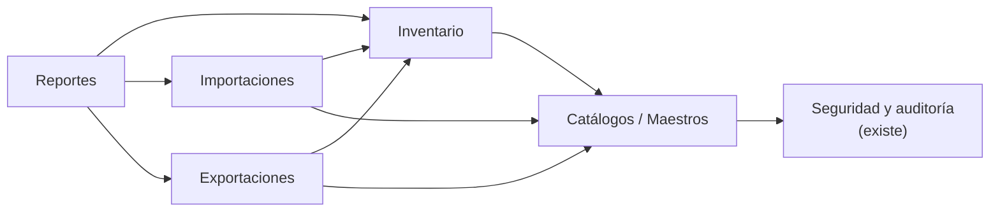
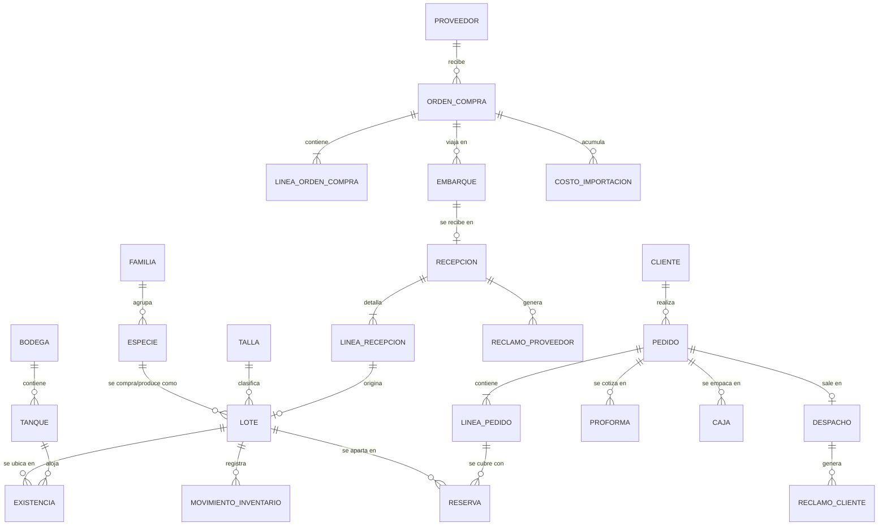

# Mapa de módulos — JR Tropical Fish

Visión funcional de los módulos del sistema, sus entidades principales, permisos, dependencias y el orden
sugerido de construcción. Es la base para construir los módulos de negocio, que todavía no existen: hoy solo
está el esqueleto (login, usuarios, perfiles, permisos, auditoría, archivos en S3, PDF con QuestPDF y correo).

Documentos relacionados:

- [`glosario.md`](glosario.md) — términos del negocio.
- [`inventario.md`](inventario.md), [`importaciones.md`](importaciones.md),
  [`exportaciones.md`](exportaciones.md) — detalle funcional de cada módulo de negocio.
- [`../design-thinking/00-overview.md`](../design-thinking/00-overview.md) — descubrimiento con el negocio.

## Convenciones transversales

| Tema | Convención |
|---|---|
| Identificadores | UUID v7 en todas las entidades. Los documentos de negocio además tienen un **consecutivo legible** por tipo (p. ej. `OC-2026-0001`, `PF-2026-0001`, `PL-2026-0001`). |
| Auditoría | Todo cambio queda auditado (quién, cuándo, qué cambió). Los movimientos de inventario son inmutables: se corrigen con un movimiento contrario, nunca editándolos. |
| Permisos | Formato `modulo:accion`, en minúsculas; acciones compuestas con guion medio (`inventario:aprobar-ajuste`). Se separa **registrar** de **aprobar/cerrar** cuando la responsabilidad es distinta. |
| Archivos | Facturas, certificados, permisos CITES, AWB, packing lists y fotos se guardan en S3, validados por *magic bytes*: PDF, JPG, PNG o WEBP, máximo 10 MB. Video no está soportado hoy (ver preguntas abiertas en cada módulo). |
| PDFs generados | Proforma, packing list, factura comercial, acta de recepción y reportes de inventario (QuestPDF). |
| Moneda | Compras y ventas internacionales normalmente en USD; contabilidad local en COP. Cada documento guarda su moneda y, cuando aplique, la TRM usada **(por validar)**. |
| Cantidades | Los peces se manejan en **unidades enteras (piezas)**. |

## Módulos

### 1. Seguridad y auditoría (implementado)

- **Propósito**: autenticación, usuarios, perfiles con permisos, registro de auditoría y servicios
  transversales (archivos S3, PDF, correo).
- **Entidades principales**: Usuario, Perfil, Permiso, RegistroAuditoria, Archivo.
- **Estado**: implementado el 2026-11-18. Pantallas de Usuarios, Perfiles y Mi cuenta; bloqueo por
  intentos fallidos, revocación inmediata de sesiones e historial de cambios. Reglas en
  [`../arquitectura/02-backend.md`](../arquitectura/02-backend.md#políticas-de-acceso).
- **Permisos**:

| Código | Descripción | Estado |
|---|---|---|
| `usuarios:leer` | Consultar usuarios | Existe |
| `usuarios:crear` | Crear usuarios | Existe |
| `usuarios:editar` | Editar usuarios | Existe |
| `usuarios:eliminar` | Desactivar y reactivar usuarios | Existe |
| `perfiles:leer` | Consultar perfiles | Existe |
| `perfiles:crear` | Crear perfiles | Existe |
| `perfiles:editar` | Editar perfiles | Existe |
| `perfiles:eliminar` | Eliminar perfiles | Existe |
| `auditoria:leer` | Consultar el registro de auditoría | Propuesto |

### 1b. Administración: Empleados y Maestros (implementado)

- **Propósito**: información básica y laboral del personal, y las listas de valores (maestros) que
  usan los formularios.
- **Estado**: implementado el 2026-11-20. Menú «Administración» con dos pantallas:
  - **Empleados**: identificación (tipo y número, nombres, apellidos, género, fecha de nacimiento),
    contacto (teléfono, correo, dirección, ciudad), datos laborales (cargo, área, tipo de contrato,
    fechas de ingreso y retiro, salario) y foto (JPG/PNG/WEBP, 10 MB). Ficha, activar/desactivar,
    borrado lógico e historial.
  - **Maestros**: pantalla genérica con un selector; hoy **Tipos de identificación** (sembrado: CC, CE,
    TI, PA, PPT), **Cargos**, **Áreas** y **Tipos de contrato** (sembrado: indefinido, fijo, obra o
    labor, prestación de servicios, aprendizaje). Una tabla por maestro; receta para agregar otro en
    [`../arquitectura/02-backend.md`](../arquitectura/02-backend.md#maestros).
- **Tipo de identificación ≠ TipoDocumento**: el primero es el documento de identidad de una persona;
  `TipoDocumento` (módulo 2) sigue reservado para los documentos de importación/exportación.
- **Salario protegido**: sin `empleados:ver-salario` el salario no viaja en ninguna respuesta (ni en el
  historial), no se puede fijar y al editar se conserva el guardado.
- **Permisos**:

| Código | Descripción | Estado |
|---|---|---|
| `maestros:leer` | Consultar maestros | Existe |
| `maestros:editar` | Crear, editar y eliminar valores de maestros | Existe |
| `empleados:leer` | Consultar empleados | Existe |
| `empleados:crear` | Crear empleados | Existe |
| `empleados:editar` | Editar empleados (incluida la foto) | Existe |
| `empleados:eliminar` | Desactivar y eliminar empleados | Existe |
| `empleados:ver-salario` | Ver y editar el salario | Existe |

### 1c. CRM comercial y logístico (implementado)

- **Propósito**: pipeline de ventas, ventas unificadas (nacional y exportación), torre de control de
  vuelos con DOA, tareas diarias de los comerciales, metas y comisiones. Detalle y reglas en
  [`crm.md`](crm.md).
- **Estado**: implementado el 2026-11-21. Menú «Comercial»: Dashboard, Pipeline, Ventas, Torre de
  vuelos, Tareas, Clientes y Metas. Clientes importados del Excel de control comercial.
- **Entidades**: Cliente, Oportunidad, Venta, TrackingVuelo, Tarea, MetaComercial,
  ParametrosComerciales, Consecutivo.
- **Relación con el resto del mapa**:
  - `Cliente` nace aquí: el módulo 2 (Catálogos) lo **reutiliza y amplía** (moneda, lista de precios,
    ventana de reclamo); no se crea otro.
  - El CRM no maneja líneas por especie (viven en la app de inventario). El futuro módulo 5
    (Exportaciones, pedido por línea) referenciará `ventas.id`, y su despacho alimentará el
    `tracking_vuelos` en vez de digitarlo.
- **Permisos**: `clientes:leer`, `clientes:editar`, `crm:leer`, `crm:vender`, `crm:ver-todo`,
  `ventas:gestionar`, `tracking:gestionar`, `metas:leer`, `metas:editar` (tabla en
  [`crm.md`](crm.md#permisos)). `clientes:*` ya existe: la tabla del módulo 2 los conserva.

### 2. Catálogos / Maestros (primera parte implementada)

- **Propósito**: datos de referencia compartidos por todos los módulos de negocio.
- **Estado** (2026-11-21): implementados **Productos** (catálogo / stock list), **Listas de precios**
  con reglas y recálculo, **Centros de acopio**, **Proveedores** y los maestros *Grupos de producto* y
  *Cuencas*; importados del Excel «JR MAIN STOCK LIST» y «BASES». Detalle en
  [`catalogos.md`](catalogos.md). Pendientes de esta lista: Bodega, Tanque (llegan con Inventario),
  AgenteCarga/Aerolínea, Aeropuerto, CausaMortalidad, ConceptoCosto, TipoDocumento, TipoCaja, y datos
  extra de Especie (CITES, cuarentena, densidad por talla).
- **Entidades principales**: Familia, Especie (nombre científico, nombres comunes, indicador CITES y
  apéndice, días mínimos de cuarentena, densidad por bolsa por talla), Talla, Bodega, Tanque (tipo,
  capacidad), Proveedor (país, moneda, incoterm, ventana de reclamo), Cliente (país, aeropuerto destino,
  moneda, lista de precios, ventana de reclamo), ListaPrecios, AgenteCarga/Aerolínea, Aeropuerto,
  CausaMortalidad, ConceptoCosto, TipoDocumento, TipoCaja.
- **Permisos**:

| Código | Descripción |
|---|---|
| `catalogos:leer` | Consultar catálogos técnicos (productos, centros de acopio…) (existe) |
| `catalogos:editar` | Crear, editar y desactivar catálogos técnicos (existe) |
| `catalogos:ver-costos` | Ver y editar el costo de compra (existe) |
| `proveedores:leer` | Consultar proveedores (existe) |
| `proveedores:editar` | Crear, editar y desactivar proveedores (existe) |
| `clientes:leer` | Consultar clientes (existe, creado con el CRM) |
| `clientes:editar` | Crear, editar y desactivar clientes (existe, creado con el CRM) |
| `precios:leer` | Consultar listas de precios (existe) |
| `precios:editar` | Editar precios, listas, reglas y recalcular (existe) |

- **Depende de**: Seguridad.

### 3. Inventario

- **Propósito**: stock vivo por especie, talla, lote y tanque; movimientos, mortalidad, cuarentena, conteos
  físicos y alertas. Detalle en [`inventario.md`](inventario.md).
- **Entidades principales**: Lote, Existencia, MovimientoInventario, SolicitudAjuste, ConteoFisico,
  Reserva, Alerta.
- **Permisos**:

| Código | Descripción |
|---|---|
| `inventario:leer` | Consultar stock, lotes, tanques y movimientos (sin costos) |
| `inventario:ver-costos` | Ver costos unitarios y valorización del inventario |
| `inventario:ingresar` | Registrar entradas manuales (producción propia, compra local, carga inicial) |
| `inventario:trasladar` | Registrar traslados entre tanques |
| `inventario:registrar-mortalidad` | Registrar mortalidad con causa |
| `inventario:reclasificar` | Registrar reclasificación de talla |
| `inventario:ajustar` | Registrar solicitudes de ajuste |
| `inventario:aprobar-ajuste` | Aprobar o rechazar ajustes |
| `inventario:liberar-cuarentena` | Liberar o bloquear lotes (cuarentena/bloqueado a disponible) |
| `inventario:contar` | Registrar conteos físicos |
| `inventario:cerrar-conteo` | Cerrar conteos y generar los ajustes resultantes |
| `inventario:configurar` | Configurar stock mínimo, umbrales y alertas |

- **Depende de**: Catálogos, Seguridad.

### 4. Importaciones

- **Propósito**: compras a proveedores del exterior, desde la orden de compra hasta la liberación de los
  lotes a inventario, con costeo landed y reclamos DOA. Detalle en [`importaciones.md`](importaciones.md).
- **Entidades principales**: OrdenCompra, LineaOrdenCompra, Embarque, DocumentoImportacion, Recepcion,
  LineaRecepcion, CostoImportacion, Liquidacion, ReclamoProveedor.
- **Permisos**:

| Código | Descripción |
|---|---|
| `importaciones:leer` | Consultar órdenes de compra, embarques, recepciones y reclamos |
| `importaciones:gestionar` | Crear y editar órdenes de compra, registrar embarques y cargar documentos |
| `importaciones:aprobar` | Aprobar órdenes de compra para enviarlas al proveedor |
| `importaciones:recibir` | Registrar la recepción física (conteo, DOA, faltantes) |
| `importaciones:cerrar-recepcion` | Cerrar la recepción, generar el acta y crear los lotes en cuarentena |
| `importaciones:costear` | Registrar costos de nacionalización y ejecutar el prorrateo |
| `importaciones:liquidar` | Aprobar la liquidación de costos y cerrar la importación |
| `importaciones:reclamar` | Crear y gestionar reclamos DOA al proveedor |

- **Depende de**: Inventario, Catálogos, Seguridad.

### 5. Exportaciones

- **Propósito**: venta a clientes del exterior, desde la lista de disponibilidad hasta el despacho y la
  atención de reclamos. Detalle en [`exportaciones.md`](exportaciones.md).
- **Entidades principales**: Pedido, LineaPedido, Proforma, Reserva (de Inventario), Caja, ContenidoCaja,
  DocumentoExportacion, FacturaComercial, Despacho, ReclamoCliente.
- **Permisos**:

| Código | Descripción |
|---|---|
| `exportaciones:leer` | Consultar pedidos, proformas, despachos y reclamos |
| `exportaciones:cotizar` | Crear pedidos, generar y enviar proformas y listas de disponibilidad |
| `exportaciones:aprobar-precio` | Aprobar precios por debajo de la lista o descuentos especiales |
| `exportaciones:confirmar` | Confirmar pedidos (reserva stock) y cancelarlos (libera reserva) |
| `exportaciones:empacar` | Registrar preparación y empaque (cajas, bolsas, cantidades reales) |
| `exportaciones:documentar` | Generar packing list y factura comercial, y cargar certificados, CITES y AWB |
| `exportaciones:despachar` | Registrar el despacho (salida de inventario) |
| `exportaciones:reclamar` | Registrar reclamos DOA del cliente |
| `exportaciones:aprobar-reclamo` | Aprobar o rechazar reclamos y su compensación |

- **Depende de**: Inventario, Catálogos, Seguridad.

### 6. Reportes

- **Propósito**: consultas consolidadas y PDFs de inventario, importaciones y exportaciones; indicadores
  para gerencia.
- **Entidades principales**: no tiene entidades propias de negocio; lee de los demás módulos (vistas o
  consultas de solo lectura). Puede guardar definiciones de reportes programados.
- **Reportes iniciales sugeridos**: existencias por tanque/especie/talla (PDF), inventario valorizado,
  kardex por lote, mortalidad por periodo/causa/proveedor, DOA por proveedor y por cliente, costo landed por
  importación, ventas por cliente/especie, margen por pedido.
- **Permisos**:

| Código | Descripción |
|---|---|
| `reportes:inventario` | Reportes operativos de inventario (sin costos) |
| `reportes:importaciones` | Reportes de importaciones y DOA de proveedores |
| `reportes:exportaciones` | Reportes de ventas, despachos y DOA de clientes |
| `reportes:gerencial` | Reportes con costos, valorización y márgenes |

- **Depende de**: Inventario, Importaciones, Exportaciones, Catálogos.

## Dependencias entre módulos

La flecha se lee "depende de". Importaciones y Exportaciones **no dependen entre sí**: se comunican solo a
través de Inventario (los lotes que entran por importación son los que se reservan y despachan en
exportación). Esto permite construirlas en cualquier orden.

## Vista general de entidades

Los documentos (certificados, CITES, AWB, facturas, fotos) se asocian a la entidad correspondiente mediante
el servicio de archivos existente; no se dibujan para no recargar el diagrama.

## Perfiles sugeridos

Los perfiles son editables; esta es una propuesta inicial **por validar** con el negocio. Hoy existen
Administrador, Operativo y Consulta.

| Perfil | Permisos de negocio principales |
|---|---|
| Administrador | Todos |
| Gerencia | Lectura de todo, `inventario:ver-costos`, todas las aprobaciones (`*:aprobar*`, `importaciones:liquidar`, `inventario:cerrar-conteo`), `reportes:*` |
| Jefe de bodega | `inventario:*` excepto `ver-costos` y `configurar`, `importaciones:recibir`, `importaciones:cerrar-recepcion`, `exportaciones:empacar`, `reportes:inventario` |
| Operario de acuarios | `inventario:leer`, `inventario:trasladar`, `inventario:registrar-mortalidad`, `inventario:contar`, `importaciones:recibir`, `exportaciones:empacar` |
| Comercio exterior | `importaciones:*` excepto `liquidar`, `exportaciones:*` excepto `aprobar-precio` y `aprobar-reclamo`, `inventario:leer`, `clientes:*`, `proveedores:*`, `precios:leer` |
| Consulta | Permisos `:leer` y `reportes:inventario` |

## Orden de construcción sugerido (fases MVP)

| Fase | Alcance | Resultado para el negocio |
|---|---|---|
| 0. Esqueleto (hecho) | Login, usuarios, perfiles, permisos, auditoría, S3, PDF, correo | Base técnica lista |
| 1. Maestros | Especies, familias, tallas, bodegas, tanques, causas de mortalidad, proveedores, clientes | El negocio tiene su catálogo digital |
| 2. Inventario base | Carga inicial de stock, lotes, existencias por tanque, traslados, mortalidad, ajustes con aprobación, liberación de cuarentena, reporte de existencias en PDF | Stock real y confiable por tanque |
| 3. Exportaciones núcleo | Lista de disponibilidad, pedido, proforma (PDF + correo), confirmación con reserva, empaque, packing list y factura comercial (PDF), checklist documental, despacho con salida de inventario | Se deja de vender lo que no hay; documentos sin retrabajo |
| 4. Importaciones núcleo | Orden de compra, documentos del proveedor, embarque/AWB, recepción con conteo y DOA, acta de recepción (PDF), lotes en cuarentena | Trazabilidad de lo que llega y evidencia para reclamar |
| 5. Costeo y reclamos | Costos de nacionalización, prorrateo, costo landed, liquidación; reclamos DOA a proveedor y de cliente | Costo real por lote y recuperación de pérdidas |
| 6. Reportes y alertas | Conteos físicos completos, alertas por correo, reportes gerenciales (valorización, márgenes, DOA por proveedor/cliente) | Decisiones con datos |

**Por qué exportaciones antes que importaciones**: es el flujo que genera ingresos y el de mayor riesgo
operativo (sobreventa, errores en documentos con ventana de vuelo rígida). Mientras no exista Importaciones,
el stock importado se registra con `inventario:ingresar`. Si para el negocio el dolor principal está en las
importaciones (DOA no reclamado, costos desconocidos), se invierten las fases 3 y 4 sin impacto técnico,
porque ambos módulos solo dependen de Inventario.

## Preguntas abiertas

1. ¿Hay una sola bodega o varias? ¿Hay estanques externos o granjas de producción propia?
2. ~~¿Se compra a acopiadores o pescadores nacionales?~~ Sí: hay 77 proveedores nacionales por centro de
   acopio (catálogo). Importaciones probablemente se generalice a "Compras" nacional/internacional.
3. ~~¿Hay ventas locales además de exportaciones?~~ Sí: el CRM maneja ventas nacionales y de exportación.
4. ¿La misma persona maneja importaciones y exportaciones? Esto define si conviene un solo perfil de
   "comercio exterior".
5. ¿Quién debe aprobar ajustes, liquidaciones y descuentos: solo el dueño o también un jefe?
6. ¿Se requiere integración con facturación electrónica DIAN o con el software contable en una fase
   cercana?
